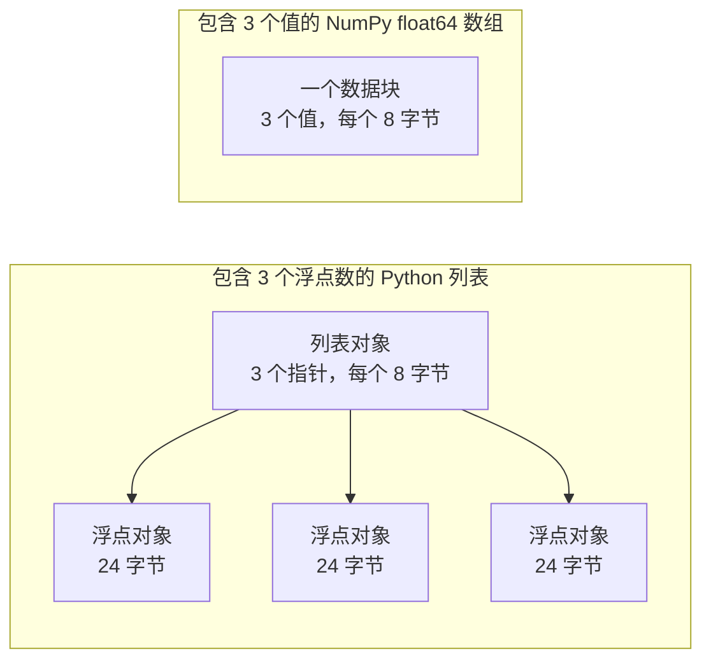

# 面向 AI 工程的 Python

> 本课程的大多数代码都依赖一小组 Python 惯用法。先掌握它们，再阅读后续的数学和模型课程。

**类型：** 构建
**语言：** Python
**前置课程：** 开发环境、Python 环境
**预计时间：** 约 120 分钟

## 学习目标


- 读写课程代码最常见的惯用法，从解包和 f-string 到数据类与推导式。
- 找出三种不会报错却会产生错误结果的 Python 问题：共享列表、可变默认值和已耗尽的生成器。
- 只用标准库构建 CSV/JSON 加载器、固定种子的划分器和小批量生成器。
- 用纯 Python 编写点积、均值和标准差，并测量它们的速度与内存占用。
- 解释纯 Python 数字循环为何很慢，以及 NumPy 广播如何把循环移入编译代码。

## 问题


本阶段之后的课程用朴素 Python 表达数学和模型。在课程的 541 个 Python 文件中，有 276 个导入 `dataclasses`，另有 187 个调用 `random.seed` 或创建 `random.Random` 生成器。如果这些惯用法还不熟悉，阅读数学时就会被语法打断。

Python 还有一些不会报错却会产生错误结果的行为。两个名称可以指向同一个列表，因此通过一个名称修改也会影响另一个名称。默认参数会把值从一次调用保留到下一次。生成器遍历一次后就为空，所以第二个训练 epoch 读不到数据，损失也不会变化。

最后一个问题是速度。在测试笔记本上，纯 Python 遍历一百万个浮点数约需 30 毫秒，而 NumPy 计算同一个点积不到 1 毫秒。理解原因后，你才能在清晰的循环和数组运算之间做出选择。

## 概念


### 课程代码实际使用什么


我们用 `ast` 模块解析了 `phases/*/*/code/` 下的全部 541 个 Python 文件。表格统计至少使用过一次各构造的文件数。数字来自本课编写当天，新增课程后可能变化。

| 构造 | 文件数 | 占比 |
|-----------|-------|-------|
| 函数定义 | 541 | 100% |
| `if __name__ == "__main__":` | 529 | 98% |
| f-string | 517 | 96% |
| 元组解包 | 448 | 83% |
| 类 | 379 | 70% |
| 列表推导式 | 375 | 69% |
| 函数类型提示 | 342 | 63% |
| 生成器表达式 | 326 | 60% |
| 切片 | 314 | 58% |
| `lambda` | 175 | 32% |
| `try` 与 `except` | 120 | 22% |
| `with` 语句 | 96 | 18% |
| 字典推导式 | 93 | 17% |
| 带 `yield` 的生成器函数 | 14 | 3% |

导入情况能说明哪些标准模块最重要。在 541 个文件中，340 个以 `from __future__ import annotations` 开头，276 个导入 `dataclasses`。`math`、`random` 和 `json` 分别出现在 187、175 和 126 个文件中；`collections` 出现在 70 个文件中，`itertools` 只出现在 4 个文件中。

没有课程调用 `map()` 或 `filter()`，推导式承担了这些工作。超过 140 个文件调用带 `key=` 函数的 `sorted`、`min`、`max` 或 `.sort`。本课会重点讲解这些统计表顶部的惯用法。

### 名称指向对象


在 Python 中，变量是指向对象的名称。赋值只是把名称绑定到对象，不会复制对象。当两个名称指向同一个列表时，通过任一名称做出的修改都会在两处可见。数字、字符串和元组不可变，因此通常不会因此出问题；列表、字典和集合可变，需要独立版本时要显式复制。

### 列表保存指针，数组保存数字


Python 列表并不直接保存数字，而是保存指针，每个指针指向一个完整的 Python 对象。在 64 位 CPython 中，一个指针占 8 字节，一个 `float` 对象占 24 字节；NumPy 的 `float64` 数组则把原始的 8 字节数值连续存放在一块内存中。



遍历列表时，每个元素都要执行许多工作。解释器一次执行一条字节码指令：对每个元素跟随指针、检查每个操作数的类型，再调用浮点乘法代码并创建一个 Python 浮点对象保存结果。

NumPy 在编译代码中遍历原始数值并完成同样的运算。它只需为整个数组检查一次数据类型，也不会为每个元素创建 Python 对象。向量化代码描述对整个数组执行的一次操作，例如 `(x - mean) / std`，由库来运行循环。本课的向量函数遵循这一原则：每个函数只做一次数组运算，之后可以用一个 NumPy 调用替换。

### 列表保存所有项目，生成器一次保存一个


列表推导式会在下一行执行前构造所有元素；生成器则在调用者请求下一个元素时才构造一个元素。列表占用的内存随元素数量增长，而生成器无论潜在元素数量多少，内存占用都大致不变。

生成器只能运行一次。取出最后一个元素后，每次请求都会抛出 `StopIteration`，因此第二个 `for` 循环拿不到任何元素。训练代码每个 epoch 都要读取数据集，所以必须为每个 epoch 创建新的生成器。

课程代码中直接定义生成器函数的地方不多，但深度学习课程的数据加载器都是批次可迭代对象，因此这一思想出现在每个训练循环中。图中用同样的八行数据展示了两种方式。

```figure
s0-list-vs-generator
```

## 你需要掌握的惯用法


本节每个代码块都可以独立运行。把代码保存到文件后用 `python3` 执行。代码需要 Python 3.11 或更高版本，也就是开发环境课程中安装的版本。

### 1. 值、集合与解包


Python 有四种内置集合，下面说明各自的适用场景。

| 类型 | 示例 | 有序 | 可变 | 课程中的典型用途 |
|------|---------|---------|------------|---------------------------|
| `list` | `[0.5, 1.2]` | 是 | 是 | 样本、损失、权重 |
| `tuple` | `(32, 784)` | 是 | 否 | 形状、固定记录、字典键 |
| `dict` | `{"lr": 0.01}` | 按插入顺序 | 是 | 配置、词表、JSON 行 |
| `set` | `{"cat", "dog"}` | 否 | 是 | 唯一 token、重叠检查 |

本代码块说明赋值不会复制列表。

```python
weights = [0.5, -1.2, 3.0]
alias = weights
alias[0] = 99.0
print(weights)

independent = list(weights)
independent[1] = 0.0
print(weights, independent)

grid = [[0] * 3] * 2
grid[0][0] = 1
print(grid)

grid = [[0] * 3 for _ in range(2)]
grid[0][0] = 1
print(grid)
```

```text
[99.0, -1.2, 3.0]
[99.0, -1.2, 3.0] [99.0, 0.0, 3.0]
[[1, 0, 0], [1, 0, 0]]
[[1, 0, 0], [0, 0, 0]]
```

表达式 `[[0] * 3] * 2` 创建的外层列表包含两个指向同一个内层列表的引用；推导式则为每一行创建新的内层列表。数学阶段会用列表构建矩阵，因此应使用推导式写法。

解包可以在一行中把序列元素赋给多个名称，带星号的名称会收集剩余元素。f-string 把表达式的值插入字符串，冒号后还可以指定格式。

```python
shape = (32, 784)
batch_size, n_features = shape
first, *middle, last = [1, 2, 3, 4, 5]
x, y = 1.0, 3.0
x, y = y, x

config = {"lr": 0.01, "epochs": 5}
config["seed"] = 7
tokens = ["the", "cat", "sat", "on", "the", "mat"]
vocab = set(tokens)

print(batch_size, n_features, first, middle, last, x, y)
print(config.get("momentum", 0.9), "cat" in vocab, len(vocab))
print(f"lr={config['lr']:.0e} loss={0.123456:.3f} n={60_000:,} {batch_size=}")
```

```text
32 784 1 [2, 3, 4] 5 3.0 1.0
0.9 True 5
lr=1e-02 loss=0.123 n=60,000 batch_size=32
```

键不存在时，`dict.get` 会返回默认值。对集合使用 `in` 检查时，无论集合大小如何，耗时大致相同。`{batch_size=}` 写法会同时打印名称和值，便于调试。

切片 `a[start:stop:step]` 包含 `start`，不包含 `stop`；负索引从末尾计数。列表切片会创建新列表，因此大型列表切片会复制所有指针。

```python
tokens = ["<s>", "the", "cat", "sat", "on", "the", "mat", "</s>"]
print(tokens[1:-1])
print(tokens[:3], tokens[-3:])
print(tokens[::2])
print(tokens[::-1][:2])
windows = [tokens[i:i + 3] for i in range(len(tokens) - 2)]
print(len(windows), windows[0])
```

```text
['the', 'cat', 'sat', 'on', 'the', 'mat']
['<s>', 'the', 'cat'] ['the', 'mat', '</s>']
['<s>', 'cat', 'on', 'mat']
['</s>', 'mat']
6 ['<s>', 'the', 'cat']
```

### 2. 推导式


推导式用一个表达式从可迭代对象构建列表、字典或集合，读起来通常像它所表达的数学式。

```python
scores = [0.91, 0.42, 0.77, 0.15, 0.66]
labels = [1 if s >= 0.5 else 0 for s in scores]
high = [s for s in scores if s > 0.6]
squares = {i: i * i for i in range(4)}
lengths = {len(word) for word in ["a", "bb", "cc", "ddd"]}
sum_sq = sum(s * s for s in scores)

matrix = [[1, 2, 3], [4, 5, 6]]
transposed = [list(column) for column in zip(*matrix)]
flat = [v for row in matrix for v in row]

print(labels, high, squares, lengths, round(sum_sq, 4))
print(transposed, flat)
```

```text
[1, 0, 1, 0, 1] [0.91, 0.77, 0.66] {0: 0, 1: 1, 2: 4, 3: 9} {1, 2, 3} 2.0555
[[1, 4], [2, 5], [3, 6]] [1, 2, 3, 4, 5, 6]
```

末尾的 `if` 只保留满足条件的元素。`for` 前的表达式可以是条件表达式 `a if condition else b`。两个 `for` 子句的执行顺序与两层嵌套循环相同。

用圆括号包围表达式即可得到生成器表达式。在 `sum(s * s for s in scores)` 中，`sum` 一次读取一个平方值，Python 不会创建列表。在 `zip(*matrix)` 中，星号把每一行作为独立参数传入，`zip` 再配对各位置的元素。

### 3. 函数、参数与闭包


默认值让参数变成可选参数；关键字参数在调用时明确写出参数名。参数列表中单独的 `*` 会把后续参数设为仅限关键字参数。

```python
def clip(value, low=0.0, high=1.0):
    return max(low, min(high, value))


def train(data, *, lr=0.01, epochs=3):
    return f"{len(data)} samples, lr={lr}, epochs={epochs}"


def make_scaler(factor):
    def scale(values):
        return [v * factor for v in values]
    return scale


print(clip(1.7), clip(-3.0, low=-1.0), clip(0.4, high=0.3))
print(train([1, 2, 3], lr=0.1))
to_percent = make_scaler(100)
print(to_percent([0.25, 0.5]))
```

```text
1.0 -1.0 0.3
3 samples, lr=0.1, epochs=3
[25.0, 50.0]
```

有了仅限关键字参数，`train(data, 0.1, 3)` 这样的调用会抛出 `TypeError`。调用者必须写成 `lr=0.1`，两个数字就不会因为位置交换而产生错误。

内部函数 `scale` 使用创建它的外层函数中的 `factor`。只要 `scale` 仍存在，Python 就会保留 `factor`。保留创建者变量的函数称为闭包；“动手实现”中的标准化器就用闭包保存训练统计量。

`lambda` 是没有名称、只包含一个表达式的函数。课程代码主要把它用作 `key=` 函数，第 8 节会展示这种用法。

Python 在执行 `def` 语句时只计算一次默认值。每次使用该默认值调用函数时，拿到的都是同一个对象。

```python
def add_bad(item, bucket=[]):
    bucket.append(item)
    return bucket


def add_good(item, bucket=None):
    if bucket is None:
        bucket = []
    bucket.append(item)
    return bucket


add_bad("a")
print(add_bad("b"))
add_good("a")
print(add_good("b"))
```

```text
['a', 'b']
['b']
```

列表、字典或集合参数应以 `None` 为默认值，并在函数内部创建新对象。

### 4. 类与数据类


`@dataclass` 装饰器会根据带注解的字段生成 `__init__`、`__repr__` 和 `__eq__`。设置 `frozen=True` 后，对象创建后不能修改，还可以作为字典键或放入集合。

```python
from dataclasses import dataclass, field


@dataclass(frozen=True)
class Example:
    features: tuple[float, ...]
    label: int


@dataclass
class TrainConfig:
    lr: float = 0.01
    epochs: int = 5
    hidden: list[int] = field(default_factory=lambda: [64, 32])

    def describe(self):
        return f"lr={self.lr} epochs={self.epochs} hidden={self.hidden}"


ex = Example((1.5, 2.0), 1)
print(ex)
print(ex == Example((1.5, 2.0), 1), len({ex, Example((1.5, 2.0), 1)}))
print(TrainConfig(epochs=10).describe())
try:
    ex.label = 0
except AttributeError as err:
    print(type(err).__name__)
```

```text
Example(features=(1.5, 2.0), label=1)
True 1
lr=0.01 epochs=10 hidden=[64, 32]
FrozenInstanceError
```

`field(default_factory=...)` 会为每个实例创建新列表，在数据类中解决第 3 节的共享默认值问题。

特殊方法把类与 Python 语法连接起来：`len(ds)` 会调用 `__len__`，`ds[2]` 会调用 `__getitem__`。

```python
class SquaresDataset:
    def __init__(self, n):
        self.n = n

    def __len__(self):
        return self.n

    def __getitem__(self, index):
        if not 0 <= index < self.n:
            raise IndexError(index)
        return index, index * index


ds = SquaresDataset(4)
print(len(ds), ds[2])
print(list(ds))
```

```text
4 (2, 4)
[(0, 0), (1, 1), (2, 4), (3, 9)]
```

即使没有 `__iter__` 方法，`list(ds)` 内部的 `for` 循环也能工作。Python 会依次用 0、1、2 等索引调用 `__getitem__`，直到得到 `IndexError`。PyTorch 的 map-style 数据集也使用同样的两个方法：`__len__` 和 `__getitem__`。

### 5. 迭代器与生成器


可迭代对象就是能被 `for` 循环接受的对象。`iter()` 从中取得迭代器，`next()` 向迭代器请求一个元素。迭代器没有更多元素时会抛出 `StopIteration`；`for` 循环会替你调用 `next()`，并在遇到该异常时停止。

```python
numbers = [10, 20, 30]
it = iter(numbers)
print(next(it), next(it), next(it))
try:
    next(it)
except StopIteration:
    print("no more items")


def countdown(n):
    while n > 0:
        yield n
        n -= 1


gen = countdown(3)
print(type(gen).__name__)
print(list(gen))
print(list(gen))
```

```text
10 20 30
no more items
generator
[3, 2, 1]
[]
```

函数体中包含 `yield` 的函数是生成器函数。调用它时不会执行函数体，而是返回生成器对象。每次 `next()` 都会执行到下一个 `yield` 并在那里暂停。第二次 `list(gen)` 为空，是因为第一次调用已经耗尽了生成器。

生成器可以逐行读取文件。

```python
import os
import tempfile


def read_rows(path):
    with open(path, encoding="utf-8") as fh:
        header = fh.readline().rstrip("\n").split(",")
        for line in fh:
            yield dict(zip(header, line.rstrip("\n").split(",")))


with tempfile.TemporaryDirectory() as tmp:
    path = os.path.join(tmp, "rows.csv")
    with open(path, "w", encoding="utf-8") as fh:
        fh.write("x,label\n")
        fh.writelines(f"{i * 0.5},{i % 2}\n" for i in range(5))
    rows = read_rows(path)
    print(next(rows))
    print(sum(1 for _ in rows))
```

```text
{'x': '0.0', 'label': '0'}
4
```

`read_rows` 每次只把文件的一行留在内存中，图中展示的就是这个函数。为保持示例简短，它按逗号拆分行；真实 CSV 可以在引号字段中包含逗号，因此“动手实现”使用 `csv` 模块。

```python
import sys

as_list = [i * i for i in range(1_000_000)]
as_generator = (i * i for i in range(1_000_000))
print(sys.getsizeof(as_list), sys.getsizeof(as_generator))
print(sum(as_list) == sum(as_generator))
```

在 64 位 CPython 中，列表报告约 8 MB，生成器约 200 字节。`sys.getsizeof` 只统计列表中的指针，整数对象本身还会占用更多内存。“动手实现”用我们在调试与性能分析课程中介绍的 `tracemalloc` 测量真实峰值。

### 6. 上下文管理器与异常


`with` 语句依次运行准备代码、主体和清理代码，即使主体抛出异常也会执行清理。`open()` 返回的文件对象就是一个会关闭文件的上下文管理器。

在调试与性能分析课程中，我们用 `__enter__` 和 `__exit__` 编写了 `Timer` 类。`contextlib.contextmanager` 装饰器可以从生成器创建同类对象：`yield` 之前的代码负责准备，`finally` 块负责清理。

```python
import time
from contextlib import contextmanager


@contextmanager
def timer(label):
    start = time.perf_counter()
    try:
        yield
    finally:
        print(f"{label}: {(time.perf_counter() - start) * 1000:.1f} ms")


def parse_label(text):
    try:
        return int(text)
    except ValueError:
        raise ValueError(f"label must be an integer, got {text!r}") from None


with timer("sum of squares"):
    total = sum(i * i for i in range(200_000))

print(parse_label("3"))
try:
    parse_label("cat")
except ValueError as err:
    print("rejected:", err)
```

```text
sum of squares: 9.4 ms
3
rejected: label must be an integer, got 'cat'
```

你机器上的耗时会不同。在 `except` 子句中写出预期的具体异常类型，例如 `ValueError` 或 `KeyError`。不写异常类型的 `except:` 还会捕获 `KeyboardInterrupt`，因此包含它的循环可能无法响应 Ctrl+C。输入错误时应抛出带清晰消息的异常；如果自己的消息要替代原始回溯，可以加上 `from None`。

### 7. 类型提示、模块与 main 守卫


类型提示告诉读者函数接收和返回什么。Python 运行代码时不会检查类型提示；mypy 等类型检查器会在运行前读取它们。

```python
from __future__ import annotations

from collections.abc import Iterable, Sequence


def mean(values: Sequence[float]) -> float:
    if not values:
        raise ValueError("mean() needs at least one value")
    return sum(values) / len(values)


def count_tokens(docs: Iterable[str]) -> int:
    return sum(len(doc.split()) for doc in docs)


def main() -> None:
    print(mean([1.0, 2.0, 4.0]))
    print(count_tokens(["the cat sat", "on the mat"]))
    print(mean.__annotations__)


if __name__ == "__main__":
    main()
```

```text
2.3333333333333335
6
{'values': 'Sequence[float]', 'return': 'float'}
```

使用 `from __future__ import annotations` 后，Python 会把每个提示保存为字符串，最后一行会显示这一点。`Sequence` 表示具有 `len()` 和索引的对象，例如列表或元组；`Iterable` 表示任何能被 `for` 循环接受的对象。课程中的许多文件也从 `typing` 导入这些名称，这同样可行。

每个 `.py` 文件都是一个模块。用 `python3 file.py` 运行文件时，Python 将其 `__name__` 设为 `"__main__"`；被其他文件导入时，`__name__` 则是模块名。main 守卫只在前一种情况下调用 `main()`，所以 `code/tests/` 中的测试可以导入 `main.py`，而不会自动启动演示。

### 8. 文件、JSON、CSV 与排序


`pathlib.Path` 用 `/` 拼接路径，并能在一次调用中读写整个文件。始终显式指定 `encoding="utf-8"`，因为默认编码取决于操作系统。

```python
import csv
import json
import tempfile
from pathlib import Path

rows = [
    {"text": "great movie", "label": 1, "score": 0.93},
    {"text": "boring plot", "label": 0, "score": 0.12},
    {"text": "fine acting", "label": 1, "score": 0.58},
]

with tempfile.TemporaryDirectory() as tmp:
    json_path = Path(tmp) / "reviews.json"
    json_path.write_text(json.dumps(rows, indent=2), encoding="utf-8")
    from_json = json.loads(json_path.read_text(encoding="utf-8"))

    csv_path = Path(tmp) / "reviews.csv"
    with csv_path.open("w", newline="", encoding="utf-8") as fh:
        writer = csv.DictWriter(fh, fieldnames=["text", "label", "score"])
        writer.writeheader()
        writer.writerows(rows)
    with csv_path.open(newline="", encoding="utf-8") as fh:
        from_csv = list(csv.DictReader(fh))

print(from_json == rows)
print(from_csv[0])

by_score = sorted(rows, key=lambda r: r["score"], reverse=True)
print([r["text"] for r in by_score])
print(max(rows, key=lambda r: r["score"])["text"])
print([r["text"] for r in sorted(rows, key=lambda r: (-r["label"], r["text"]))])
```

```text
True
{'text': 'great movie', 'label': '1', 'score': '0.93'}
['great movie', 'fine acting', 'boring plot']
great movie
['fine acting', 'great movie', 'boring plot']
```

JSON 会保留数字类型；CSV 返回的每个字段都是字符串，因此必须逐字段转换。按照 `csv` 文档的建议，打开 CSV 文件时要使用 `newline=""`。

`key=` 函数返回 Python 用来比较每个元素的值，`sorted`、`min` 和 `max` 都接受它。元组键先按第一个值排序，只有相等时才比较第二个值；负号可以让较大的标签排在前面。Python 的排序是稳定的，键相等的元素会保持原有顺序。

### 9. 计数、分组与迭代器工具


这两个模块提供了普通列表和字典没有的数据结构与迭代器工具。

```python
from collections import Counter, defaultdict, deque
from itertools import chain, islice, product

labels = ["cat", "dog", "cat", "bird", "cat", "dog"]
counts = Counter(labels)
print(counts.most_common(2))

positions = defaultdict(list)
for i, label in enumerate(labels):
    positions[label].append(i)
print(dict(positions))

recent = deque(maxlen=3)
for loss in [2.0, 1.5, 1.2, 1.1, 0.9]:
    recent.append(loss)
print(list(recent), round(sum(recent) / len(recent), 3))

print(list(product([0.1, 0.01], [16, 32])))
print(list(chain([1, 2], [3], [4, 5])))
print(list(islice(range(100), 5, 10)))
```

```text
[('cat', 3), ('dog', 2)]
{'cat': [0, 2, 4], 'dog': [1, 5], 'bird': [3]}
[1.2, 1.1, 0.9] 1.067
[(0.1, 16), (0.1, 32), (0.01, 16), (0.01, 32)]
[1, 2, 3, 4, 5]
[5, 6, 7, 8, 9]
```

`Counter` 用于统计可哈希元素，例如标签或 token。第一次使用新键时，`defaultdict(list)` 会创建空列表，因此分组循环无需检查键是否存在。`deque(maxlen=3)` 加入第四项时会删除最旧项，可形成最近损失的滑动窗口。`enumerate` 会同时给出元素及其索引。

`product` 生成输入的所有组合，可用来构造超参数网格。`chain` 把多个可迭代对象首尾相接；`islice` 可以从任意迭代器（包括生成器）取切片。“动手实现”中的小批量生成器就使用了 `islice`。

### 10. 为什么数字循环很慢


`dis` 模块会打印解释器执行某个函数时运行的字节码指令。

```python
import dis


def dot(a, b):
    total = 0.0
    for x, y in zip(a, b):
        total += x * y
    return total


dis.dis(dot)
```

从 `FOR_ITER` 到跳回该指令的指令序列会为每个元素执行一次，也就是每次乘加约十条指令。具体指令名称会随 Python 版本变化。

循环中以字节码执行的步骤越少，速度越快。`sum`、`map` 和 `zip` 等内置函数用 C 编写。“动手实现”用纯 Python 测量这种差异，“实际使用”则把整个循环移入 NumPy。

## 动手实现


现在把后续课程需要的部件组合起来。完整版本位于 `code/main.py`，由 `code/tests/test_main.py` 测试。下面每个代码块都能独立运行。

### 步骤 1：记录类型与数据集加载器


加载器把 CSV 或 JSON 文件读成统一结构：由浮点特征组成的元组和一个整数标签。

```python
import csv
import json
import tempfile
from dataclasses import dataclass
from pathlib import Path


@dataclass(frozen=True)
class Record:
    features: tuple[float, ...]
    label: int


def row_to_record(row, names, label_field="label"):
    if label_field not in row:
        raise ValueError(f"row has no {label_field!r} field: {row}")
    if set(row) != {*names, label_field}:
        raise ValueError(f"row fields {list(row)} do not match {[*names, label_field]}")
    return Record(tuple(float(row[name]) for name in names), int(row[label_field]))


def load_records(path, label_field="label"):
    path = Path(path)
    if path.suffix == ".json":
        rows = json.loads(path.read_text(encoding="utf-8"))
    elif path.suffix == ".csv":
        with path.open(newline="", encoding="utf-8") as fh:
            rows = list(csv.DictReader(fh))
    else:
        raise ValueError(f"unsupported file type: {path.suffix!r}")
    if not rows:
        return []
    names = [key for key in rows[0] if key != label_field]
    return [row_to_record(row, names, label_field) for row in rows]


with tempfile.TemporaryDirectory() as tmp:
    csv_path = Path(tmp) / "data.csv"
    csv_path.write_text("x1,x2,label\n1.5,60,1\n1.8,82.5,0\n", encoding="utf-8")
    json_path = Path(tmp) / "data.json"
    json_path.write_text('[{"x1": 1.5, "x2": 60, "label": 1}]', encoding="utf-8")
    print(load_records(csv_path))
    print(load_records(json_path))
```

```text
[Record(features=(1.5, 60.0), label=1), Record(features=(1.8, 82.5), label=0)]
[Record(features=(1.5, 60.0), label=1)]
```

第一行确定特征名称及其顺序。`DictReader` 和 `json.loads` 会保留文件中的键顺序，字典也会保留键的添加顺序。JSON 标准不规定对象键的顺序，因此 `row_to_record` 会按第一行的顺序通过名称读取每一行。标签缺失、特征缺失或多余、文件类型未知时都会带消息抛出 `ValueError`，坏文件会在运行开始就终止流程。`main.py` 还提供 `save_records`，可写出同样的两种格式。

### 步骤 2：固定随机种子的训练集/测试集划分


```python
import random


def train_test_split(items, test_fraction=0.2, seed=0):
    if not 0.0 < test_fraction < 1.0:
        raise ValueError(f"test_fraction must be between 0 and 1, got {test_fraction}")
    if len(items) < 2:
        raise ValueError(f"need at least 2 items to split, got {len(items)}")
    order = list(range(len(items)))
    random.Random(seed).shuffle(order)
    n_test = min(max(1, round(len(items) * test_fraction)), len(items) - 1)
    test = [items[i] for i in order[:n_test]]
    train = [items[i] for i in order[n_test:]]
    return train, test


items = list(range(10))
print(train_test_split(items, seed=1))
print(train_test_split(items, seed=1) == train_test_split(items, seed=1))
print(train_test_split(items, seed=2)[1])
print(items)
```

```text
([9, 7, 5, 3, 0, 4, 1, 2], [6, 8])
True
[5, 9]
[0, 1, 2, 3, 4, 5, 6, 7, 8, 9]
```

`random.Random(seed)` 会创建私有随机数生成器。`random.seed(seed)` 会重置所有模块共享的全局生成器，因此其他库的一次调用可能改变你的序列。课程中有 100 个文件调用 `random.seed`，96 个文件创建 `random.Random`；新代码应使用私有生成器。

该函数打乱索引列表，因此不会修改输入列表。相同种子始终产生相同划分。两边都至少保留一个元素，所以少于 2 个元素的列表会抛出 `ValueError`。应在任何会从数据中学习的步骤（例如标准化）之前划分数据；调试与性能分析课程已经说明，训练集和测试集重叠会让测试分数虚高。

### 步骤 3：小批量生成器


```python
from itertools import islice


def batches(items, batch_size, drop_last=False):
    if batch_size < 1:
        raise ValueError(f"batch_size must be at least 1, got {batch_size}")
    return _batch_iter(iter(items), batch_size, drop_last)


def _batch_iter(iterator, batch_size, drop_last):
    while True:
        batch = list(islice(iterator, batch_size))
        if not batch or (drop_last and len(batch) < batch_size):
            return
        yield batch


print(list(batches(range(10), 4)))
print(list(batches(range(10), 4, drop_last=True)))
squares = (i * i for i in range(7))
print([len(b) for b in batches(squares, 3)])

for epoch in range(2):
    sizes = [len(b) for b in batches(range(10), 4)]
    print(f"epoch {epoch}: {sizes}")
```

```text
[[0, 1, 2, 3], [4, 5, 6, 7], [8, 9]]
[[0, 1, 2, 3], [4, 5, 6, 7]]
[3, 3, 1]
epoch 0: [4, 4, 2]
epoch 1: [4, 4, 2]
```

`islice` 从迭代器中最多取出 `batch_size` 个元素。`batches` 只要求参数支持 `iter()`，因此列表、文件和其他生成器都可以传入。长度不是批次大小整数倍时，最后一批会更小；需要固定批次形状的模型可以设置 `drop_last=True` 丢弃它。

这里拆成两个函数，是因为生成器函数直到第一次 `next()` 才执行代码。如果把检查放进生成器内部，`batches(data, 0)` 会先无错误地返回，稍后才在训练循环中报错。外层函数是普通函数，可以立即检查参数。epoch 循环会在每个 epoch 再次调用 `batches()`，因为生成器只能提供一次元素。

### 步骤 4：向量运算与标准化器


```python
import math


def dot(a, b):
    return sum(x * y for x, y in zip(a, b, strict=True))


def mean(values):
    if not values:
        raise ValueError("mean() needs at least one value")
    return sum(values) / len(values)


def std(values):
    mu = mean(values)
    return math.sqrt(sum((v - mu) ** 2 for v in values) / len(values))


def make_standardizer(rows):
    columns = list(zip(*rows))
    means = [mean(c) for c in columns]
    scales = [s if s > 0 else 1.0 for s in (std(c) for c in columns)]

    def standardize(row):
        return [(v - m) / s for v, m, s in zip(row, means, scales, strict=True)]

    return standardize


print(dot([1.0, 2.0, 3.0], [4.0, 5.0, 6.0]))
values = [2.0, 4.0, 4.0, 4.0, 5.0, 5.0, 7.0, 9.0]
print(mean(values), std(values))

train_rows = [(1.0, 100.0), (2.0, 300.0), (3.0, 500.0)]
standardize = make_standardizer(train_rows)
print([[round(v, 3) for v in standardize(r)] for r in train_rows])
print([round(v, 3) for v in standardize((4.0, 700.0))])
```

```text
32.0
5.0 2.0
[[-1.225, -1.225], [0.0, 0.0], [1.225, 1.225]]
[2.449, 2.449]
```

设置 `strict=True` 后，两个向量长度不同时 `zip` 会抛出 `ValueError`。不设置时，`zip` 会在较短输入结束处停止，静默返回错误答案。`strict` 参数需要 Python 3.10 或更高版本。

`std` 除以 `n`，因此得到的是总体标准差，与 `statistics.pstdev` 一致。用样本估计更大总体的离散程度时，应除以 `n - 1`。

`make_standardizer` 是一个闭包。它只根据训练行计算一次均值和标准差，并由 `standardize` 保存这些统计量。对测试行使用同一个函数，因此测试数据不会影响统计量。常量列的标准差为 0，标准化器会为其使用 1 作为缩放值。

### 步骤 5：完整运行


`code/main.py` 将各部件串起来：从两个簇生成 400 条记录，分别保存为 CSV 和 JSON，再读回两个文件。随后划分记录，在训练划分上拟合标准化器，并从大小为 48 的批次计算类别质心。

最近质心分类器保存每个类别的平均特征向量，并预测均值距离输入最近的类别。`fit_centroids` 按批次累加行，因此不需要把整个训练集放进内存；`predict` 使用带 `key=` 函数的 `min()` 找到最近质心。

```bash
python3 phases/00-setup-and-tooling/13-python-for-ai-engineering/code/main.py
```

```text
Python for AI engineering: a standard-library toolkit
data     400 records, CSV and JSON load back unchanged: True
split    320 train, 80 test, records in both: 0
batches  size 48: [48, 48, 48, 48, 48, 48, 32]
scale    train feature means after standardizing: [0.0, 0.0]
model    nearest-centroid test accuracy: raw 0.86, standardized 0.89
speed    dot product of 200,000 floats, best of 5:
           index loop         6.60 ms
           zip generator      5.93 ms
           map + mul          2.89 ms
memory   peak bytes to sum 100,000 squares:
           list              4,000,616
           generator               472
```

两个特征的尺度差异很大。第二个特征的离散程度是第一个的十倍，因此它主导原始距离，未标准化时准确率更低。你测得的速度和内存数值会与这里不同。

### 步骤 6：测量速度与内存


```python
import operator
import random
import time
import tracemalloc


def dot_index_loop(a, b):
    total = 0.0
    for i in range(len(a)):
        total += a[i] * b[i]
    return total


def dot_zip(a, b):
    return sum(x * y for x, y in zip(a, b, strict=True))


def dot_map(a, b):
    return sum(map(operator.mul, a, b))


def best_time(fn, *args, repeat=5):
    times = []
    for _ in range(repeat):
        start = time.perf_counter()
        fn(*args)
        times.append(time.perf_counter() - start)
    return min(times)


def peak_bytes(fn):
    tracemalloc.start()
    try:
        fn()
        return tracemalloc.get_traced_memory()[1]
    finally:
        tracemalloc.stop()


rng = random.Random(0)
a = [rng.random() for _ in range(1_000_000)]
b = [rng.random() for _ in range(1_000_000)]
for fn in (dot_index_loop, dot_zip, dot_map):
    print(f"{fn.__name__:15} {best_time(fn, a, b) * 1000:7.2f} ms")

print(peak_bytes(lambda: sum([i * i for i in range(100_000)])))
print(peak_bytes(lambda: sum(i * i for i in range(100_000))))
```

`best_time` 报告多次运行中的最快结果。机器上的其他程序只会增加耗时，因此最小值最接近真实成本；`timeit` 模块文档也给出相同建议。

在装有 Python 3.11 的测试笔记本上，索引循环约需 33 毫秒，`zip` 版本约 30 毫秒，`map` 版本约 14 毫秒。三者执行相同算术；`map` 版本更快，是因为 `map` 和 `operator.mul` 用 C 编写，每个元素需要执行的字节码更少。内存结果也印证了图示：列表约 4 MB，生成器不到 1 KB。

## 实际使用


### 标准库版本


标准库已经为你构建的大多数部件提供了经过测试的版本。

| 你构建的部件 | 标准库版本 | 说明 |
|-----------|------------------|------|
| `mean`、`std` | `statistics.fmean`、`statistics.pstdev` | 测试会与它们比较 |
| `dot` | `math.sumprod` | Python 3.12 或更高版本 |
| `batches` | `itertools.batched` | Python 3.12 或更高版本，返回元组 |
| `best_time` | `timeit.repeat` | 运行期间也会关闭垃圾回收 |
| `peak_bytes` | `tracemalloc` | 同一模块，提供快照和逐行统计 |

```python
import statistics
import sys

values = [2.0, 4.0, 4.0, 4.0, 5.0, 5.0, 7.0, 9.0]
print(statistics.fmean(values), statistics.pstdev(values))

if sys.version_info >= (3, 12):
    import math
    from itertools import batched

    print(math.sumprod([1.0, 2.0, 3.0], [4.0, 5.0, 6.0]))
    print(list(batched(range(10), 4)))
```

```text
5.0 2.0
32.0
[(0, 1, 2, 3), (4, 5, 6, 7), (8, 9)]
```

课程支持 Python 3.11，因此 `main.py` 使用自定义的 `dot` 和 `batches`。在 Python 3.11 上，代码块只会打印第一行。

### 用编译数组完成相同运算


可以在 Python 环境课程创建的虚拟环境中安装 NumPy，例如运行 `uv pip install numpy`。本课代码和测试并不依赖它。

```python
import time

import numpy as np

n = 1_000_000
rng = np.random.default_rng(0)
a = rng.random(n)
b = rng.random(n)
a_list, b_list = a.tolist(), b.tolist()

start = time.perf_counter()
slow = sum(x * y for x, y in zip(a_list, b_list))
python_ms = (time.perf_counter() - start) * 1000

start = time.perf_counter()
fast = float(a @ b)
numpy_ms = (time.perf_counter() - start) * 1000

print(f"pure Python {python_ms:8.2f} ms")
print(f"NumPy       {numpy_ms:8.2f} ms")
print(f"difference  {abs(slow - fast):.1e}")
print(a.dtype, a.itemsize, a.nbytes)
```

在测试笔记本上，NumPy 用时不到 1 毫秒，纯 Python 版本约 30 毫秒。两种结果的末几位不同，是因为它们以不同顺序累加乘积；浮点数加法改变顺序后会产生轻微差异。

NumPy 更快有三个原因：

- 数组把每个 8 字节的原始 `float64` 值存放在一块内存中；浮点数列表的每个值都需要 8 字节指针和 24 字节浮点对象。
- 循环在编译代码中运行。NumPy 只为整个数组检查一次类型，不为每个元素创建 Python 对象。
- 连续存储的数值让 NumPy 可以使用 SIMD 指令，一条指令处理多个值。

对于非常小的数组，一次 NumPy 调用的固定开销可能大于短 Python 循环。练习 4 会找出 NumPy 在你机器上开始更快的规模。

### 广播


广播让 NumPy 无需在代码中显式循环，就能组合不同形状的数组。本代码块执行与步骤 4 的 `make_standardizer` 相同的工作。

```python
import numpy as np

X = np.array([[1.0, 100.0], [2.0, 300.0], [3.0, 500.0]])
mu = X.mean(axis=0)
sigma = X.std(axis=0)
Z = (X - mu) / sigma
print(X.shape, mu.shape, Z.shape)
print(Z.round(3))

norms = np.sqrt((X ** 2).sum(axis=1, keepdims=True))
print(norms.shape, (X / norms).shape)
```

```text
(3, 2) (2,) (3, 2)
[[-1.225 -1.225]
 [ 0.     0.   ]
 [ 1.225  1.225]]
(3, 1) (3, 2)
```

NumPy 从最后一个维度向第一个维度比较两个形状。当两个维度相等或其中一个为 1 时，它们兼容；缺失的前导维度按 1 计算。大小为 1 的维度会沿较大维度重复使用，NumPy 不会复制数据。

| `X` 的形状 | 另一个数组的形状 | 结果 |
|--------------|--------------------------|--------|
| `(3, 2)` | `(2,)`，列均值 | `(3, 2)` |
| `(3, 2)` | `(3, 1)`，使用 `keepdims=True` 的行范数 | `(3, 2)` |
| `(3, 2)` | `(3,)`，不使用 `keepdims` 的行范数 | `ValueError` |

最后一行是常见错误。NumPy 会比较末尾维度 2 和 3，而两者都不是 1。沿行缩减后还要与原数组组合时，请保留 `keepdims=True`。

## 交付


本课会生成 `outputs/prompt-python-review.md`。这是一个面向 AI 和数据项目 Python 代码的审查提示词。把文件或差异交给它，它会检查本课介绍的惯用法和静默错误：

- 共享引用和可变默认参数
- 第二个 epoch 试图读取已耗尽的生成器
- 未设置种子的随机数，或只设置了全局种子
- 从测试划分计算出的统计量
- 遍历大型数值数组的纯 Python 循环

它会为每个发现报告位置、问题和修复方法。

## 练习


1. 在 `main.py` 中运行 `run_demo(seed=8)`，找出会变化和保持不变的输出行，并解释划分大小为何不变。
2. 用纯 Python 编写 `median(values)`，在奇数长度和偶数长度列表上与 `statistics.median` 对比测试。
3. 编写 `stream_records(path)`，让生成器从 CSV 文件逐条产生 `Record`。创建包含 200,000 行的文件，用 `tracemalloc` 比较 `stream_records` 与 `load_records` 的峰值内存。
4. 分别用纯 Python 和 NumPy 编写 `matvec(matrix, vector)`，对规模 4、64、1024 用 `best_time` 测量，找出 NumPy 在你机器上开始更快的规模。
5. 重现“概念”中的构造扫描：对 `phases/*/*/code/*.py` 的每个文件使用 `ast.parse` 和 `ast.walk`，统计包含 `ast.ListComp`、`ast.Yield` 和 `ast.With` 的文件，并与表格比较。

## 关键术语


| 术语 | 常见说法 | 实际含义 |
|------|----------------|----------------------|
| Iterable | “可以循环的东西” | `iter()` 能接受的对象，例如列表、文件或生成器 |
| Iterator | “游标” | 每次调用 `__next__` 返回一个元素，结束时抛出 `StopIteration` 的对象 |
| Generator | “惰性列表” | 由 `yield` 函数或生成器表达式产生的迭代器，按请求创建元素且只能运行一次 |
| Comprehension | “单行循环” | 从可迭代对象构建列表、字典或集合的表达式，可带筛选条件 |
| Closure | “函数里的函数” | 保存创建它的函数中变量的函数 |
| Dataclass | “结构体” | Python 根据带注解字段生成 `__init__`、`__repr__` 和 `__eq__` 的类 |
| Context manager | “with 块” | 在 `with` 开始时准备、结束时清理，即使发生异常也会清理的对象 |
| Seed | “随机数” | 伪随机生成器的起始值；相同种子产生相同序列 |
| Vectorized code | “快速代码” | 对整个数组执行一次操作，让编译代码负责循环的代码 |
| Broadcasting | “自动形状匹配” | NumPy 使用大小为 1 的维度重复组合不同形状数组、且不复制数据的规则 |

## 延伸阅读


- [Python 教程：数据结构](https://docs.python.org/3/tutorial/datastructures.html)：列表、元组、集合、字典和推导式。
- [Python 教程：类](https://docs.python.org/3/tutorial/classes.html)：作用域、类、迭代器和生成器。
- [dataclasses](https://docs.python.org/3/library/dataclasses.html)：装饰器的全部选项，包括 `frozen` 和 `field`。
- [collections](https://docs.python.org/3/library/collections.html)：`Counter`、`defaultdict`、`deque` 和其他容器类型。
- [itertools](https://docs.python.org/3/library/itertools.html)：`islice`、`chain`、`product`、`batched` 及组合它们的配方。
- [排序技巧](https://docs.python.org/3/howto/sorting.html)：键函数、稳定排序和多键排序。
- [timeit](https://docs.python.org/3/library/timeit.html)：如何测量小段代码，以及为何报告最小值。
- [random](https://docs.python.org/3/library/random.html)：全局生成器、`random.Random` 实例和可复现性。
- [PEP 255：简单生成器](https://peps.python.org/pep-0255/)：加入 `yield` 的提案及其设计原因。
- [NumPy：广播](https://numpy.org/doc/stable/user/basics.broadcasting.html)：带图示的完整形状规则。
- [Harris 等，《使用 NumPy 的数组编程》，Nature 585，2020](https://doi.org/10.1038/s41586-020-2649-2)：NumPy 数组的设计及其速度来源。
