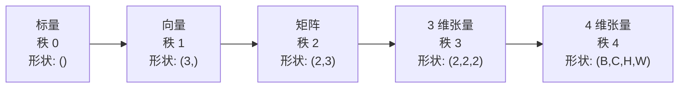
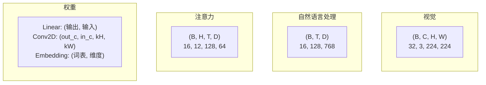
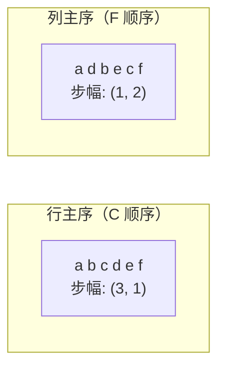
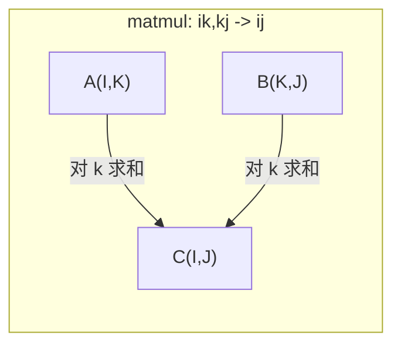

# 张量运算

> 张量是数据和深度学习的共同语言：每张图、每个句子、每个梯度都在其中流动。

**类型：** 实作  
**学习实现：** Python  
**前置课程：** Phase 1 · 第 01–02 课  
**预计时间：** 约 90 分钟

## 学习目标

- 从零写出有 shape、strides、reshape、transpose 和逐元素操作的张量类。
- 以广播规则在不复制数据下操作不同 shape 的张量。
- 用 einsum 表达点积、矩阵乘、外积与批处理操作。
- 逐步追踪 multi-head attention 的所有精确形状。

## 问题

你搭了一个 Transformer，前向看起来很干净。一运行却得到：`RuntimeError: mat1 and mat2 shapes cannot be multiplied (32x768 and 512x768)`。你盯着这些形状，试着做一次转置，这下它又说 `Expected 4D input (got 3D input)`。你加了一个 unsqueeze，别的地方又坏了。

形状错误是深度学习代码中最常见的 bug。它们在概念上并不难——每个操作都有一份形状契约——但会迅速累积。一个 Transformer 把几十个 reshape、transpose 和广播串联在一起，一条轴搞错，错误就会级联。更糟的是，有些形状错误根本不抛异常，它们会沿着错误的维度广播、或在错误的轴上求和，从而无声地产生垃圾结果。

矩阵处理两组事物之间的成对关系。真实数据并不止于二维。一批 32 张 224×224 的 RGB 图像是一个 4 维张量：`(32, 3, 224, 224)`。12 个头的自注意力也是 4 维：`(batch, heads, seq_len, head_dim)`。你需要一种能推广到任意维数的数据结构，其操作能在所有维度上干净地组合。这种结构就是张量。掌握它的操作，形状错误就变得极易调试。

## 概念

### 什么是张量 <!-- learning-atlas: what-a-tensor-is -->

张量是具有统一数据类型的多维数值数组。维度的数目是**秩**（rank，或 order）。每个维度是一条**轴**（axis）。**形状**（shape）是列出每条轴大小的元组。

总元素数等于所有大小之积。形状 `(2, 3, 4)` 含 $2 \cdot 3 \cdot 4 = 24$ 个元素。

### 深度学习中的张量形状

不同的数据类型按惯例映射到特定的张量形状。

PyTorch 使用 NCHW（通道在前），TensorFlow 默认 NHWC（通道在后）。布局不一致会导致无声的变慢或报错。

### 内存布局如何工作

内存中的二维数组是一段一维字节序列。**步幅**（stride）告诉你沿每条轴前进一步需要跳过多少个元素。

转置并不移动数据。它交换步幅，使张量变得**非连续**（non-contiguous）——同一行的元素在内存中不再相邻。

### 广播 <!-- learning-atlas: broadcasting-rules -->

广播让你在不复制数据的情况下操作不同形状的张量。从右端对齐形状。当两个维度相等或其中一个为 1 时它们才兼容。维数较少的一方在左侧补 1。下面“动手构建”开头的填充示例展示了对齐规则。

### Einsum 与 attention <!-- learning-atlas: einsum-the-universal-tensor-operation -->

爱因斯坦求和为每条轴标记一个字母。出现在输入中但不出现在输出中的轴会被求和，两边都出现的轴会被保留。

常用模式：`i,i->`（点积）、`i,j->ij`（外积）、`ii->`（迹）、`ij->ji`（转置）、`bij,bjk->bik`（批量矩阵乘）、`bhtd,bhsd->bhts`（注意力分数）。

## 动手构建

代码位于 `code/tensors.py`。每个步骤都对应其中的实现。以下保留上游的图示与代码块；“广播”一节提到的填充对齐示例在本节开头给出。







```
Tensor A:     (8, 1, 6, 1)
Tensor B:        (7, 1, 5)
Padded B:     (1, 7, 1, 5)
Result:       (8, 7, 6, 5)
```



```figure
tensor-broadcast
```

### 步骤 1：张量存储与步幅

张量存储一个扁平的数字列表，外加形状元数据。步幅告诉索引逻辑如何把多维索引映射到扁平位置。

```python
class Tensor:
    def __init__(self, data, shape=None):
        if isinstance(data, (list, tuple)):
            self._data, self._shape = self._flatten_nested(data)
        elif isinstance(data, np.ndarray):
            self._data = data.flatten().tolist()
            self._shape = tuple(data.shape)
        else:
            self._data = [data]
            self._shape = ()

        if shape is not None:
            total = reduce(lambda a, b: a * b, shape, 1)
            if total != len(self._data):
                raise ValueError(
                    f"Cannot reshape {len(self._data)} elements into shape {shape}"
                )
            self._shape = tuple(shape)

        self._strides = self._compute_strides(self._shape)

    @staticmethod
    def _compute_strides(shape):
        if len(shape) == 0:
            return ()
        strides = [1] * len(shape)
        for i in range(len(shape) - 2, -1, -1):
            strides[i] = strides[i + 1] * shape[i + 1]
        return tuple(strides)
```

对形状 `(3, 4)`，步幅为 `(4, 1)`——跳过 4 个元素前进一行，跳过 1 个元素前进一列。

### 步骤 2：reshape、squeeze 与 unsqueeze

reshape 在不改变元素顺序的前提下改变形状。元素总数必须保持不变。用 `-1` 作为某一维，可让它自动推断大小。

```python
t = Tensor(list(range(12)), shape=(2, 6))
r = t.reshape((3, 4))
r = t.reshape((-1, 3))
```

squeeze 去掉大小为 1 的轴，unsqueeze 插入一条。unsqueeze 对广播至关重要——把偏置向量 `(D,)` 加到批次 `(B, T, D)` 上，需要先 unsqueeze 为 `(1, 1, D)`。

```python
t = Tensor(list(range(6)), shape=(1, 3, 1, 2))
s = t.squeeze()
v = Tensor([1, 2, 3])
u = v.unsqueeze(0)
```

### 步骤 3：transpose 与 permute

转置交换两条轴。permute 重排所有轴。这就是你在 NCHW 和 NHWC 之间转换的方式。

```python
mat = Tensor(list(range(6)), shape=(2, 3))
tr = mat.transpose(0, 1)

t4d = Tensor(list(range(24)), shape=(1, 2, 3, 4))
perm = t4d.permute((0, 2, 3, 1))
```

转置或 permute 之后，张量在内存中变为非连续。在 PyTorch 中，`view` 会在非连续张量上失败——请改用 `reshape`，或先调用 `.contiguous()`。

### 步骤 4：逐元素运算与归约

逐元素运算（加、乘、减）对每个元素独立作用并保持形状。归约（sum、mean、max）折叠一条或多条轴。

```python
a = Tensor([[1, 2], [3, 4]])
b = Tensor([[10, 20], [30, 40]])
c = a + b
d = a * 2
s = a.sum(axis=0)
```

CNN 中的全局平均池化：`(B, C, H, W).mean(axis=[2, 3])` 产出 `(B, C)`。NLP 中的序列均值池化：`(B, T, D).mean(axis=1)` 产出 `(B, D)`。

### 步骤 5：使用 NumPy 广播

`tensors.py` 中的 `demo_broadcasting_numpy()` 函数展示了核心模式。

```python
activations = np.random.randn(4, 3)
bias = np.array([0.1, 0.2, 0.3])
result = activations + bias

images = np.random.randn(2, 3, 4, 4)
scale = np.array([0.5, 1.0, 1.5]).reshape(1, 3, 1, 1)
result = images * scale

a = np.array([1, 2, 3]).reshape(-1, 1)
b = np.array([10, 20, 30, 40]).reshape(1, -1)
outer = a * b
```

借助广播计算成对距离：把 `(M, 2)` reshape 为 `(M, 1, 2)`、把 `(N, 2)` reshape 为 `(1, N, 2)`，相减、平方、沿最后一轴求和，再开平方根。结果为 `(M, N)`。

### 步骤 6：einsum 运算

`demo_einsum()` 和 `demo_einsum_gallery()` 函数逐一走过每一种常见模式。

```python
a = np.array([1.0, 2.0, 3.0])
b = np.array([4.0, 5.0, 6.0])
dot = np.einsum("i,i->", a, b)

A = np.array([[1, 2], [3, 4], [5, 6]], dtype=float)
B = np.array([[7, 8, 9], [10, 11, 12]], dtype=float)
matmul = np.einsum("ik,kj->ij", A, B)

batch_A = np.random.randn(4, 3, 5)
batch_B = np.random.randn(4, 5, 2)
batch_mm = np.einsum("bij,bjk->bik", batch_A, batch_B)
```

一次缩并的计算成本是所有指标大小（保留的和求和的）之积。对 `bij,bjk->bik`，当 $B=32$、$I=128$、$J=64$、$K=128$ 时：$32 \cdot 128 \cdot 64 \cdot 128 = 33{,}554{,}432$ 次乘加。

### 步骤 7：通过 einsum 实现注意力

`demo_attention_einsum()` 函数端到端地实现了多头注意力。

```python
B, H, T, D = 2, 4, 8, 16
E = H * D

X = np.random.randn(B, T, E)
W_q = np.random.randn(E, E) * 0.02

Q = np.einsum("bte,ek->btk", X, W_q)
Q = Q.reshape(B, T, H, D).transpose(0, 2, 1, 3)

scores = np.einsum("bhtd,bhsd->bhts", Q, K) / np.sqrt(D)
weights = softmax(scores, axis=-1)
attn_output = np.einsum("bhts,bhsd->bhtd", weights, V)

concat = attn_output.transpose(0, 2, 1, 3).reshape(B, T, E)
output = np.einsum("bte,ek->btk", concat, W_o)
```

每一步都是一次张量操作：投影（通过 einsum 做矩阵乘）、拆分多头（reshape + transpose）、注意力分数（通过 einsum 做批量矩阵乘）、加权求和（通过 einsum 做批量矩阵乘）、合并多头（transpose + reshape）、输出投影（通过 einsum 做矩阵乘）。

## 使用

### 从零实现与 NumPy

| 操作 | Scratch（Tensor 类） | NumPy |
|---|---|---|
| 创建 | `Tensor([[1,2],[3,4]])` | `np.array([[1,2],[3,4]])` |
| Reshape | `t.reshape((3,4))` | `a.reshape(3,4)` |
| Transpose | `t.transpose(0,1)` | `a.T` 或 `a.transpose(0,1)` |
| Squeeze | `t.squeeze(0)` | `np.squeeze(a, 0)` |
| Sum | `t.sum(axis=0)` | `a.sum(axis=0)` |
| Einsum | 不适用 | `np.einsum("ij,jk->ik", a, b)` |

### 从零实现与 PyTorch

```python
import torch

t = torch.tensor([[1, 2, 3], [4, 5, 6]], dtype=torch.float32)
t.shape
t.stride()
t.is_contiguous()

t.reshape(3, 2)
t.unsqueeze(0)
t.transpose(0, 1)
t.transpose(0, 1).contiguous()

torch.einsum("ik,kj->ij", A, B)
```

PyTorch 额外提供了自动微分、GPU 支持和优化过的 BLAS 内核。但形状语义完全相同。只要你理解从零实现的版本，PyTorch 的形状报错就变得可读。

### 每个神经网络层都是张量运算

| 操作 | 张量形式 | Einsum |
|---|---|---|
| Linear 层 | `Y = X @ W.T + b` | `"bd,od->bo"` + bias |
| Attention QKV | `Q = X @ W_q` | `"btd,dh->bth"` |
| Attention scores | `Q @ K.T / sqrt(d)` | `"bhtd,bhsd->bhts"` |
| Attention output | `softmax(scores) @ V` | `"bhts,bhsd->bhtd"` |
| Batch norm | `(X - mu) / sigma * gamma` | 逐元素运算 + 广播 |
| Softmax | `exp(x) / sum(exp(x))` | 逐元素运算 + 归约 |

## 交付

本课产出两个可复用的提示词：

1. **`outputs/prompt-tensor-shapes.md`** —— 一个系统化调试张量形状不匹配的提示词。包含每种常见操作（matmul、broadcast、cat、Linear、Conv2d、BatchNorm、softmax）的决策表，以及一张修复查找表。
2. **`outputs/prompt-tensor-debugger.md`** —— 当形状错误卡住你时，粘贴给任意 AI 助手的逐步调试提示词。把错误消息和你的张量形状喂给它，即可得到精确的修复方案。

## 练习

1. **简单——reshape 往返。** 取 `(2, 3, 4)` 张量，依次 reshape 为 `(6, 4)`、`(24,)`，再还原为 `(2, 3, 4)`；每一步打印扁平数据，验证元素顺序保持不变。
2. **中等——实现广播。** 为 `Tensor` 增加 `broadcast_to(shape)`，将大小为 1 的轴扩展到目标形状；修改 `_elementwise_op` 以便运算前自动广播。用 `(3, 1)` 与 `(1, 4)` 测试，结果应为 `(3, 4)`。
3. **困难——从零构建 einsum。** 实现基础的 `einsum(subscripts, *tensors)`，至少支持点积（`i,i->`）、矩阵乘（`ij,jk->ik`）、外积（`i,j->ij`）和转置（`ij->ji`）。解析下标字符串，识别缩并轴，遍历所有索引组合；与 `np.einsum` 对比结果。
4. **困难——注意力形状追踪器。** 编写函数接收 `batch_size`、`seq_len`、`embed_dim`、`num_heads`，打印多头注意力每一步的精确形状：输入、Q/K/V 投影、拆分多头、注意力分数、softmax 权重、加权和、合并多头、输出投影；与 `demo_attention_einsum()` 输出核对。

### 提示

**练习 1.** 用 `list(range(24))` 构造张量，使每个元素显示自己的位置。每次调用 `reshape` 后，打印 `flatten().to_list()`，确认它仍然是按顺序排列的 0 到 23。

**练习 2.** 只有当两个维度大小相等、或其中一个为 1 时才能广播，所以先检查这条规则，不满足时抛出错误。对形状 `(3, 1)` 和 `(1, 4)`，检查结果中 `[i][j]` 项是否等于 `a[i][0] + b[0][j]`，并把完整结果与 NumPy 对比。

**练习 3.** 在 `->` 处拆分下标。出现在输入中但不在输出中的字母是求和指标，所以遍历每个字母的所有取值，累加到对应的输出位置。用小的随机数组对四种情况逐一测试：`np.allclose(mine, np.einsum(...))`。

**练习 4.** 从每个头的大小 `embed_dim // num_heads` 开始，并断言 `embed_dim % num_heads == 0`。注意力分数的形状为 `(batch_size, num_heads, seq_len, seq_len)`，因此把你的打印结果与该形状、以及 `demo_attention_einsum()` 打印的各形状进行核对。

## 关键术语

| 术语 | 常用说法 | 准确定义 |
|---|---|---|
| 张量 | “更多维的矩阵” | 具有统一类型、确定形状、步幅和操作的多维数组。 |
| 秩（rank） | “维度数” | 轴的数目；矩阵的秩为 2，而非它的矩阵秩。 |
| 形状（shape） | “张量大小” | 列出每轴大小的元组。`(2, 3)` 表示 2 行 3 列。 |
| 步幅（stride） | “内存布局” | 沿每一轴前进一个逻辑位置需跳过的元素数。 |
| 广播 | “形状不同也能算” | 一组严格规则：从右对齐，维度必须相等或其中一方为 1。 |
| 连续（contiguous） | “正常内存” | 元素在内存中顺序存放，相对逻辑布局没有间隙或重排。 |
| Einsum | “高级矩阵乘” | 一种能用一行表达任意张量缩并、外积、迹或转置的通用记法。 |
| 视图（view） | “等于 reshape” | 与原张量共用同一内存缓冲、但形状/步幅元数据不同的张量；在非连续数据上会失败。 |
| 缩并（contraction） | “对指标求和” | 把张量间共享的指标相乘再求和的通用操作，结果秩更低。 |
| NCHW / NHWC | “PyTorch 与 TensorFlow 格式” | 图像张量的内存布局约定；NCHW 把通道放在空间维之前，NHWC 放在之后。 |

## 延伸阅读

- [NumPy Broadcasting](https://numpy.org/doc/stable/user/basics.broadcasting.html)
- [PyTorch Tensor Views](https://pytorch.org/docs/stable/tensor_view.html)
- [einops](https://github.com/arogozhnikov/einops)
- [The Illustrated Transformer](https://jalammar.github.io/illustrated-transformer/)
- [NumPy einsum](https://numpy.org/doc/stable/reference/generated/numpy.einsum.html)
