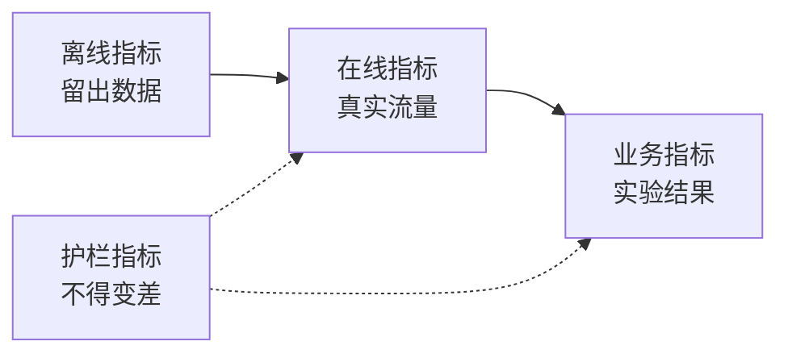

# 机器学习系统设计：从问题到部署模型

> 模型只是系统的一部分。设计要决定模型预测什么、谁根据预测行动、成本是多少，以及失败时怎么办。

**类型：** 构建
**语言：** Python
**前置课程：** Phase 2 第 09 课（模型评估）和第 13 课（ML 管道）
**预计时间：** 约 110 分钟

## 学习目标


- 把业务问题表述为包含预测、使用预测的决策，以及说明规则为何不够的 ML 任务。
- 区分离线、在线、业务和护栏指标，并将每个模型与朴素基线和启发式基线比较。
- 根据流量数字估算批量和在线推理的每日成本、延迟与陈旧程度。
- 选择 shadow、canary 或 A/B 发布模式，并为每种故障规定安全默认值。
- 找出模型改变下一版本训练数据的反馈回路。
- 编写 ML 设计文档，并用固定清单评分。

## 问题


一家订阅公司提出“做一个流失模型”。数据科学家训练梯度提升分类器，报告 AUC 为 0.91；三个月后却没有人使用它。

原因与算法无关。没有人决定分数要触发什么行动。分数每周才到一次，但留存团队每天都要联系客户。标签来自同时记录取消原因的取消表，因此某个特征直接包含了答案。也没有人把模型和支持团队已有的规则比较：联系连续两周没有活动的人。

这些问题都发生在训练开始之前，属于设计失败；一页设计文档应逐项提出这些问题。本课讲解文档中的决策，并构建一个工具包：估算批量与在线服务成本、将模型与基线比较、按清单为设计文档评分。

## 概念


### 从业务目标到 ML 任务


业务目标本身不是 ML 任务，需要用四个问题把它具体化：

1. 模型究竟预测什么，针对哪个实体（用户、支付、商店、商品）？
2. 哪个决策会使用预测，由谁或什么系统做出该决策？
3. 什么时候需要预测，在那个时刻有哪些数据可用？
4. 如何知道决策变好了？

| 业务目标 | 预测 | 使用预测的决策 | ML 任务 |
|---|---|---|---|
| 降低流失 | 用户未来 30 天内取消的概率 | 每晚向排名前 5% 的用户发送挽留优惠 | 二分类 |
| 降低欺诈损失 | 一笔支付属于欺诈的概率 | 在 100 毫秒内批准、复核或拦截 | 二分类 |
| 保持货架有货 | 下周每家门店每天的销量 | 为每家门店确定订货量 | 预测 |
| 展示相关商品 | (用户、商品) 对的相关性分数 | 决定信息流中的商品顺序 | 排序 |

第二列最需要谨慎。“预测流失”没有说明时间范围、实体和行动；“预测该用户是否会在未来 30 天内取消，以便今晚的任务挑选发送优惠的人”才同时固定了三者。

### 什么时候不该使用 ML


Google《机器学习规则》第 1 条建议不要害怕在没有机器学习的情况下上线产品。机器学习需要数据，而简单启发式通常已经能完成一部分目标。出现以下情况时不要使用 ML：

- 简短规则已经达到目标且保持正确；规则更便宜，也更容易运行、测试和解释。
- 没有标签，也没有实际可行的收集方式。
- 没有人根据预测采取行动，因此预测变好也不会改变任何事情。
- 预测时可用的数据不包含所需信号。
- 一次错误都不可接受，且没有人能检查输出。
- 构建和运行系统的成本高于更好决策带来的价值。

当规则变得冗长脆弱时，ML 才开始体现价值。同一指南的第 3 条倾向于用 ML 替代复杂启发式，因为学习到的模型更容易更新和维护。

### 三层指标


ML 系统要从三个层面测量，并另外设置一组限制：

| 层面 | 何时可以测量 | 流失示例 |
|---|---|---|
| 离线指标 | 上线前，在历史留出数据上 | 优惠阈值处的 F1、前 5% 用户的精确率 |
| 在线指标 | 上线期间，在真实流量上 | 优惠接受率、获得评分的用户比例、分数分布 |
| 业务指标 | 上线数周后，通过实验 | 实验组与留出组的 30 天流失率 |
| 护栏指标 | 始终监控 | 每挽回一名用户的优惠成本、退订率、p99 延迟 |



这些层面的结果经常不一致。离线指标评估历史数据，而历史数据中没有你的模型；在线指标取决于人们如何响应决策；业务指标变化缓慢，还会混入公司其他因素的噪声。

选择与决策相匹配的离线指标。如果任务联系排名前 5% 的用户，就测量前 5% 的精确率。AUC 会平均所有阈值，包括从未使用的阈值。同一指南第 2 条要求先设计并实现指标，再决定 ML 系统要做什么。

### 基线


单独看一个指标值没有意义。如果最佳替代方案只有 0.30，F1 为 0.56 就很好；如果规则达到 0.60，它就很差。每个模型都要与三类基线比较：

- **朴素基线。** 始终预测多数类，或始终预测训练均值；模型评估课程使用过这种检查。
- **启发式基线。** 来自领域知识的规则，或在训练数据上拟合的单特征阈值。
- **当前系统。** 今天实际做决策的任何方式，即使执行者是使用电子表格的人。

提升量等于模型分数减去最强基线的分数。查看结果前先设定最低提升，并让提升足以覆盖额外系统的成本。朴素基线通常很弱，真正难以击败的是启发式基线。

### 数据与标签要求


训练前先回答这些问题：

- **标签来源。** 哪张表或哪个事件定义标签，由谁负责？
- **标签延迟。** 真实结果在预测后多久到达？欺诈拒付可能在支付数周后才到达，流失标签会在 30 天预测范围结束时到达。
- **标签质量。** 谁分配标签，错误频率是多少？
- **预测时可用性。** 每个特征在预测时刻都存在吗？系统在结果发生后写入的特征会把标签泄漏到训练中。
- **每类样本量。** 有多少正例？只有 200 个正例时只能使用简单模型。
- **时间划分。** 留出最近一段时间；时间序列课程也出于同样原因按时间划分数据。

### 延迟、吞吐量与成本预算


三个数字约束每一种服务设计：

- **延迟预算。** p99 延迟表示 100 个请求中有 99 个低于该时间。支付检查可能需要 50 毫秒，而夜间报表可以花费数小时。
- **峰值吞吐量。** 按最繁忙的一分钟而非每日平均值规划系统；峰值 QPS 通常是平均值的数倍。
- **成本预算。** 用每天的金额或每 1000 次预测的金额表示，便于比较设计。

Little 定律连接前两个数字：进行中的请求数等于吞吐量乘以延迟。在每秒 400 个请求、每个请求 50 毫秒时，任意时刻约有 20 个请求正在处理。

### 批量推理与在线推理


提供预测有两种基本方式：

- **批量推理。** 定时任务为每个实体评分，并把分数写入表或键值存储；应用在请求时读取已存储的分数。
- **在线推理。** 应用在请求时把特征发送给模型服务并等待分数。

| 属性 | 批量 | 在线 |
|---|---|---|
| 新鲜度 | 最后一次运行的时间加运行耗时 | 使用请求时的数据 |
| 请求延迟 | 一次键值读取，几毫秒 | 特征读取加模型耗时 |
| 成本驱动因素 | 实体数乘以每天运行次数 | 按峰值 QPS 配置的副本数 |
| 新实体 | 下次运行前没有分数 | 第一次请求时评分 |
| 发生故障时 | 旧分数仍可读取 | 请求失败或超时 |

本课工具包会估算两者成本。批量成本随实体数和每天运行次数增长；陈旧度限制越短，运行次数越多。在线成本随峰值流量增长，因为峰值之间的空闲副本也要付费。运行一小时的批量任务无论价格如何都无法满足低于一小时的陈旧度限制。

混合设计很常见：夜间批量任务为已知用户评分，在线路径为新用户和需要新鲜数据的请求评分。

### 部署模式


新模型要分阶段接触用户：

1. **Shadow。** 新模型接收一份真实流量副本，系统记录预测但绝不使用；将延迟、错误率和预测分布与当前模型比较。
2. **Canary。** 新模型为少量流量（通常 1%–5%）做真实决策，逐步扩大比例，护栏指标破坏时回滚。
3. **A/B 测试。** 随机划分用户，让不同用户看到不同模型；用统计检验测量业务指标，需要足够流量和时间才能观察差异。

每个阶段都需要能在几分钟内完成的回滚。保留已部署的旧模型版本，用配置切换流量。LLM 服务阶段的[影子与金丝雀课程](../../../17-infrastructure-and-production/20-shadow-canary-progressive/docs/en.md)和 [A/B 测试课程](../../../17-infrastructure-and-production/21-ab-testing-llm-features/docs/en.md)介绍了语言模型的同三种模式。

### 反馈回路


当模型的决策改变了训练下一版本所用的数据时，就形成反馈回路。Sculley 等人把直接和隐藏反馈回路列为 ML 系统技术债务的主要来源。常见有三种：

- **干预隐藏标签。** 流失模型发送优惠并挽留了一部分用户；下个月高风险用户看起来很忠诚，重训模型会学到这些特征并不能预测流失。
- **拦截行动没有结果。** 欺诈模型拦截支付，该支付就不会产生拒付标签；重训模型在被拦截区域看到的欺诈样本更少。
- **曝光限制反馈。** 排序模型只展示排名靠前的商品，因此只有这些商品能收集点击。

解决方法有一个共同思路：保留一部分没有受到模型影响的数据。留出一个永远不接受干预的小型随机组，让少量流量接受随机决策，并为每个样本记录分数和决策，使后续训练能区分受影响数据与干净数据。

### 故障模式与安全默认值


系统的每个部分迟早都会失败。应在设计阶段而非故障发生时决定每种失败的默认动作：

| 故障 | 没有计划时的结果 | 安全默认值 |
|---|---|---|
| 模型服务超时 | 请求失败 | 使用启发式基线 |
| 夜间批量任务失败 | 分数缺失或过期 | 在固定时间内提供最近一次有效分数，之后使用规则 |
| 特征缺失或超出范围 | 模型为坏输入评分 | 使用文档规定的默认值并记录事件 |
| 没有历史的新实体 | 没有分数 | 使用规则或总体均值 |
| 分数分布突然变化 | 大规模做出错误决策 | 暂停自动行动并通知人员 |

指标章节中的启发式基线也是多数故障的默认方案，因此要先把它构建出来。

### 设计文档


设计文档在训练开始前把上述每个决策记录在一个地方。本课检查器会为它的 JSON 版本评分。六类缺失会阻塞评审，因为每一类都会让系统变得不安全或无用：

| 部分 | 要回答的问题 | 阻塞条件 |
|---|---|---|
| 问题 | 预测什么、哪个决策使用它、为什么规则不够？ | 该决策 |
| 指标 | 适用哪些离线、在线、业务和护栏指标？ | 业务指标 |
| 基线 | 适用哪些朴素、启发式和当前系统基线？ | 启发式或当前基线 |
| 数据 | 标签来自哪里、延迟多久、每个特征在预测时是否存在？ | 无泄漏 |
| 预算与服务 | 延迟、峰值 QPS、成本和陈旧度限制是什么，哪种服务模式满足它们？ | 无 |
| 发布 | 适用哪些 shadow、canary 和 A/B 阶段，如何回滚？ | shadow 或 canary 及回滚 |
| 反馈回路 | 模型如何改变未来数据，如何保留干净数据？ | 无 |
| 故障模式 | 每种故障的默认动作是什么？ | 每种故障都有默认值 |
| 监控 | 上线后观察什么？ | 无 |

```figure
mlprod-serving-cost
```

## 动手实现


`code/main.py` 只使用标准库，包含三个工具：服务成本模型、基线比较器和设计文档检查器。

### 步骤 1：描述工作负载与价格


工作负载记录流量数字和预算，成本模型记录价格。这里的价格是练习用的整洁数字，不是供应商报价。

```python
@dataclass(frozen=True)
class Workload:
    name: str
    entities: int
    requests_per_day: int
    peak_qps: float
    max_staleness_hours: float
    latency_budget_ms: float


@dataclass(frozen=True)
class CostModel:
    batch_dollars_per_million: float = 0.40
    batch_job_hours: float = 1.0
    lookup_dollars_per_million: float = 0.25
    lookup_latency_ms: float = 4.0
    replica_dollars_per_hour: float = 0.50
    replica_qps: float = 200.0
    min_replicas: int = 2
    online_latency_ms: float = 35.0
```

### 步骤 2：估算批量与在线服务成本


批量任务必须在陈旧度限制内完成。两次运行之间的间隔等于限制减去任务耗时。每次运行都会为所有实体评分，无论是否有人请求这些分数。

```python
def batch_plan(workload: Workload, costs: CostModel) -> ServingPlan:
    refresh_hours = workload.max_staleness_hours - costs.batch_job_hours
    if refresh_hours <= 0:
        return ServingPlan(
            "batch", False, math.inf, costs.lookup_latency_ms, math.inf, 0.0,
            "staleness limit is shorter than one batch job",
        )
    runs_per_day = 24.0 / refresh_hours
    predictions = workload.entities * runs_per_day
    dollars = (
        predictions / 1e6 * costs.batch_dollars_per_million
        + workload.requests_per_day / 1e6 * costs.lookup_dollars_per_million
    )
    ...
```

在线服务要为处理峰值所需的副本付费，并至少保留两个副本以保证可用性：

```python
def online_plan(workload: Workload, costs: CostModel) -> ServingPlan:
    replicas = max(costs.min_replicas, math.ceil(workload.peak_qps / costs.replica_qps))
    dollars = replicas * costs.replica_dollars_per_hour * 24.0
    feasible = costs.online_latency_ms <= workload.latency_budget_ms
    ...
```

`choose_serving` 保留满足延迟和陈旧度限制的方案并返回最便宜者。没有方案符合时返回 `None`，提示你调整预算。

### 步骤 3：将模型与基线比较


比较器用同一指标评估模型和每个基线，并相对于最强而非最弱的基线计算提升量。

```python
def compare_to_baselines(
    y_true: list,
    model_pred: list,
    baselines: dict[str, list],
    metric,
    metric_name: str,
    higher_is_better: bool = True,
    min_lift: float = 0.02,
) -> BaselineReport:
    if not baselines:
        raise ValueError("a model needs at least one baseline")
    scores = {name: metric(y_true, pred) for name, pred in baselines.items()}
    pick = max if higher_is_better else min
    best_name = pick(scores, key=scores.get)
    model_score = metric(y_true, model_pred)
    lift = model_score - scores[best_name] if higher_is_better else scores[best_name] - model_score
    return BaselineReport(metric_name, {"model": model_score, **scores}, best_name, lift, min_lift)
```

启发式基线是一条单特征规则。`fit_rule` 在训练数据上尝试特征的每个取值作为阈值，保留 F1 最好的阈值。演示在合成流失数据上训练小型逻辑回归，并与三个基线比较。

### 步骤 4：给设计文档评分


每个清单项都有键、权重、阻塞标志、消息和检查函数。阻塞项的权重为 2。

```python
CheckItem("decision", 2, True, "name the action that uses each prediction", lambda d: _text(d, "problem.decision")),
CheckItem("baselines", 2, True, "add a heuristic or current-system baseline", check_baselines),
CheckItem("no_leakage", 2, True, "confirm every feature exists at prediction time",
          lambda d: get_path(d, "data.features_available_at_prediction_time") is True),
CheckItem("serving_fit", 1, False, "pick a serving mode that meets the staleness, latency, and cost budgets",
          check_serving_fit),
```

`check_serving_fit` 复用成本模型，从文档读取工作负载数字并估算所选模式。模式不满足陈旧度限制、延迟预算或每日成本预算时检查失败。文档若写“batch”却要求三分钟陈旧度，也会失败。成本模型尚无混合方案，因此写“hybrid”的文档要等练习 1 加入该方案后才会通过。

`review_design_doc` 将通过项的权重相加再除以总权重。只有分数达到 0.85 且没有阻塞项失败时，结论才是“ready for review”。

### 步骤 5：运行


```bash
python3 code/main.py
```

```console
nightly churn scores
  ok batch        $0.91/day      4 ms  1.0 runs per day over 2,000,000 entities
  ok online      $24.00/day     35 ms  2 replicas sized for 40 peak QPS
  choose: batch

feed ranking, 2-hour freshness
  ok batch       $48.50/day      4 ms  24.0 runs per day over 5,000,000 entities
  ok online      $24.00/day     35 ms  2 replicas sized for 120 peak QPS
  choose: online

=== Model versus baselines (churn, metric F1) ===
  model                    0.564
  days_idle > 12.8688      0.500
  random at base rate      0.232
  majority class           0.000
  model beats the strongest baseline (days_idle > 12.8688) by +0.064
```

多数类基线的 F1 为 0，因为它从不预测流失。真正的竞争者是拟合出的规则；模型领先 0.064，因此值得部署。特征变弱时规则可能胜出，此时应部署规则系统。

设计文档评审会打印包含六个阻塞项的薄弱文档，以及得分 1.00 的完整文档。传入路径即可评审自己的文档：

```bash
python3 code/main.py my_design_doc.json
```

## 实际使用


工具包的每个部分都对应团队在生产环境中使用的工具。

**基线。** scikit-learn 以估计器形式提供朴素基线，因此可以与模型放入同一管道：

```python
from sklearn.dummy import DummyClassifier, DummyRegressor
from sklearn.metrics import f1_score

majority = DummyClassifier(strategy="most_frequent").fit(X_train, y_train)
base_rate = DummyClassifier(strategy="stratified", random_state=0).fit(X_train, y_train)
mean_value = DummyRegressor(strategy="mean").fit(X_train, y_reg_train)

print(f1_score(y_test, majority.predict(X_test)))
```

`most_frequent` 对应 `majority_baseline`，`stratified` 对应 `base_rate_baseline`。scikit-learn 没有启发式基线，因为启发式来自你的领域。

**批量服务。** Apache Airflow 或 Dagster 等工作流调度器运行评分任务，将分数写入数仓表或 Redis、DynamoDB 等键值存储。

**在线服务。** KServe、BentoML、NVIDIA Triton 和 TorchServe 等模型服务器把模型包装在 HTTP 或 gRPC 端点后面；小模型也可以直接由加载模型的普通 Web 服务提供。

**发布。** Argo Rollouts 等 Kubernetes 工具为金丝雀发布切分流量；GrowthBook 和 Statsig 等实验平台把用户分到 A/B 组并计算统计量。

**设计评审。** Breck 等人发布了 ML Test Score，包含生产 ML 系统的 28 项测试和监控要求。我们的检查器更小，先询问这些测试之前的设计问题。

## 交付


本课生成 `outputs/skill-ml-design-review.md`。该技能逐节审查 ML 设计文档，先指出阻塞缺口，并用本课的批量与在线成本算术检查服务选择。

## 练习


1. 在 `choose_serving` 中加入混合方案：批量为已知用户评分，在线为新用户评分，并比较每日成本。
2. 修改流失数据，直到模型不再胜过规则；报告消除提升所需的最小系数变化。
3. 在清单中加入 `budgets.max_dollars_per_1k_predictions` 项，并编写一个缺少它就失败的测试。
4. 为支付欺诈检查编写 JSON 设计文档，运行检查器并修复所有阻塞项。
5. 模拟流失反馈回路：删除获得优惠用户的标签，重新训练并测量 F1 的变化。

## 关键术语


| 术语 | 常见说法 | 实际含义 |
|------|----------------|----------------------|
| ML task | “构建流失模型” | 预测目标、实体、时间范围，以及使用预测的决策 |
| Offline metric | “模型分数” | 上线前在历史留出数据上计算的指标 |
| Online metric | “实时数字” | 模型运行时在真实流量上测量的指标 |
| Business metric | “目标” | 决策必须改变的公司结果，通过实验测量 |
| Guardrail metric | “不能有损害” | 新模型上线时不得变差的指标 |
| Baseline | “简单模型” | 模型必须以规定幅度击败的朴素、启发式或当前系统预测器 |
| Batch inference | “预计算分数” | 定时任务为每个实体评分并保存结果供查询 |
| Online inference | “实时模型” | 请求到达时由模型为其评分 |
| Shadow deployment | “暗发布” | 新模型评估真实流量，但无人使用其输出 |
| Canary release | “缓慢发布” | 新模型为少量且逐步增长的流量做决策，并准备好回滚 |
| Feedback loop | “模型自己训练” | 模型决策改变训练下一版本所用的数据 |

## 延伸阅读


- [Sculley 等，《机器学习系统中的隐藏技术债务》（NeurIPS 2015）](https://papers.nips.cc/paper/2015/hash/86df7dcfd896fcaf2674f757a2463eba-Abstract.html)：反馈回路、纠缠以及模型周围的系统成本。
- [Google，《机器学习规则》](https://developers.google.com/machine-learning/guides/rules-of-ml)：首个模型、指标和训练-服务一致性的实用规则。
- [Breck 等，《ML Test Score》（IEEE Big Data 2017）](https://research.google/pubs/the-ml-test-score-a-rubric-for-ml-production-readiness-and-technical-debt-reduction/)：衡量生产就绪度的 28 项测试。
- [Kohavi、Tang 与 Xu，《可信在线对照实验》（剑桥大学出版社，2020）](https://experimentguide.com/)：如何运行能给出正确答案的 A/B 测试。
- [Sato、Wider 与 Windheuser，《机器学习持续交付》（2019）](https://martinfowler.com/articles/cd4ml.html)：版本化的数据、模型和部署管道。
- [Google Cloud，《MLOps：机器学习中的持续交付与自动化管道》](https://cloud.google.com/architecture/mlops-continuous-delivery-and-automation-pipelines-in-machine-learning)：训练与服务自动化的三个成熟度级别。
