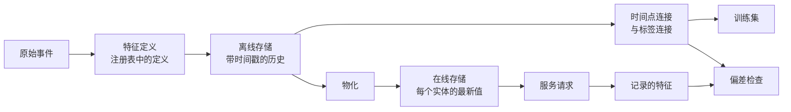

# 特征库与训练-服务偏差

> 一个特征有一份定义和两类读取者。训练按每个标签时刻读取历史，服务读取最新值；两者不一致时，模型会看到从未训练过的输入。

**类型：** 构建
**语言：** Python
**前置课程：** Phase 2 第 08 课（特征工程）、第 13 课（ML 管道）、第 15 课（时间序列）和第 19 课（ML 系统设计）
**预计时间：** 约 100 分钟

## 学习目标


- 描述离线存储、在线存储、实体、事件时间戳和 TTL，以及各自的职责。
- 实现时间点正确的连接，展示朴素连接如何把未来值复制到训练数据。
- 说出训练-服务偏差的四个原因：两条代码路径、过期特征、不同默认值和时间穿越。
- 构建特征注册表，让同一份定义同时供训练路径和服务路径使用。
- 在不读取每个日期之后数据的前提下，为过去日期回填新特征。
- 比较同一实体和时间的服务日志特征与训练路径，检测偏差。

## 问题


一个团队构建流失模型。每个标签表示用户在标签日之后 30 天内是否没有购买。团队按 `user_id` 把标签与用户特征表连接，并用 `days_since_last_purchase` 训练规则，离线准确率达到 0.948。

在真实流量上，模型表现比旧的简单版本更差。特征表保存的是每个用户的最新值，来自标签日数周之后。某用户最后一次购买在第 115 天，但第 175 天快照显示 60 天没有活动，因此特征已经包含了答案。同时，另一团队在不同服务中重新编写服务特征，30 天窗口多包含了一天，新用户默认值是 -1 而不是 365。

两个缺陷原因相同：训练和服务用两种方式计算“同一个特征”。本课从零构建特征库的各部件，包括注册表、回填、时间点连接、带 TTL 的在线存储和偏差检查，演示会用数字重现这两个缺陷。

## 概念


### 同一特征的两类读取者


训练和服务以不同形态请求特征：

| 属性 | 训练（离线） | 服务（在线） |
|---|---|---|
| 问题 | “1000 万个（实体、时间）对各自的值是什么？” | “现在这个实体的值是什么？” |
| 时间 | 过去的许多时刻 | 当前时刻 |
| 数据量 | 每个任务数百万行 | 每个请求一行 |
| 延迟 | 几分钟可以接受 | 几毫秒 |
| 存储 | 离线存储：带时间戳的完整历史，位于列式文件或数仓中 | 在线存储：每个实体的最新值，位于键值数据库中 |

特征库用同一组特征定义填充这两种存储。物化任务负责把离线存储中的最新值复制到在线存储。



### 实体、时间戳与 TTL


四个术语描述每一行特征：

- **实体。** 特征描述的键，例如 `user_id` 或 `card_id`。
- **事件时间戳。** 值生效的时间。“截至第 14 天”的购买次数，其事件时间戳就是第 14 天。
- **创建时间戳。** 系统写入该行的时间。今天运行的回填会写入旧事件时间戳和新的创建时间戳。
- **TTL（生存时间）。** 值允许的最大年龄。超过 TTL 的值视为缺失，读取者会使用默认值。

具有相同实体、来源和 TTL 的一组特征通常称为特征视图。

### 时间点正确的连接


训练行要把标签与标签时刻已经存在的特征值配对。时间点连接对每个标签执行以下步骤：

1. 找到同一实体的特征行。
2. 保留事件时间戳不晚于标签时间戳的行。
3. 取其中最新的一行。
4. 如果标签时间戳减去事件时间戳超过 TTL，则丢弃该行。

下面是一个用户、第 16 天的标签以及每周特征行：

| 特征行日期 | `purchases_30d` | 时间点连接 | 按 `user_id` 的朴素连接 |
|---|---|---|---|
| 7 | 4 | | |
| 14 | 3 | 选中 | |
| 21 | 1 | 未来 | |
| 28 | 0 | 未来 | 选中 |

标签询问用户在第 17 至 46 天是否购买。第 28 天的行已经统计了标签日之后的无活动天数，显示 0 次购买是因为用户停止购买，而这正是标签要测量的事件。朴素连接把答案复制进输入。

时间序列课程出于同样原因按时间划分数据。时间点连接把这条规则应用到每一行，而不是只应用于一个划分点。

### 训练-服务偏差的原因


Google《机器学习规则》将训练-服务偏差定义为训练期间与服务期间性能的差异，并列出三种原因：两条管道的数据处理不同、训练与服务之间数据发生变化、以及反馈回路。在特征管道中，四种具体原因反复出现：

| 原因 | 发生了什么 | 演示示例 |
|---|---|---|
| 两条代码路径 | 训练和服务用不同代码计算特征 | 服务窗口包含 `now - 30` 当天，训练窗口不包含 |
| 特征过期 | 服务读取的值与训练使用的值年龄不同 | 训练读取每周快照，新服务计算最新值 |
| 默认值不同 | 两条路径用不同方式填充缺失值 | 训练对“尚未购买”使用 365，服务使用 -1 |
| 时间穿越 | 训练读取标签时间之后的值 | 朴素连接为每个标签读取最新快照 |

同一指南第 32 条要求尽可能在训练管道和服务管道之间复用代码。特征库用一份由两条路径共同调用的定义遵循这条规则。

### 特征注册表


注册表是特征定义目录。每个条目包含名称、实体、来源、变换、窗口、默认值、TTL、负责人、版本和描述。

两条规则保证安全：

- 两条路径都从注册表读取定义，服务不能保存变换的私有副本。
- 定义发生变化时创建新版本，保留旧版本，让旧模型继续使用训练时的特征。

### 历史回填


新特征没有历史，但训练需要它在每个旧标签时刻的值。回填在每个过去日期运行定义，并为每个实体和日期写一行；每次运行只读取时间戳不晚于该日期的事件。

回填的计算成本随实体数乘日期数增长，还会带来隐蔽泄漏。今天运行的回填写入旧事件时间戳，却可能读到迟到或后来修正的数据。严格的时间点连接还要检查创建时间戳不晚于标签时间。

### 检测偏差


同一指南第 29 条要求记录服务时的特征，并将其用于训练。即使只记录少量样本，也能检查一致性。把每个日志值与训练路径为相同实体和时间产生的值比较，并为每个特征报告不匹配比例和平均绝对差。

要找出原因，比较三对结果：

1. 在线存储读取与训练连接：测试整个系统，应该显示零偏差。
2. 最新计算与训练连接：隔离特征过期问题。
3. 第二条代码路径与最新计算：隔离窗口、默认值等代码差异。

```figure
mlprod-pit-join
```

## 动手构建


`code/main.py` 只使用标准库，时间以整数天表示。每周批量任务在第 7、14 天等日期写入特征快照，直到第 175 天。

### 步骤 1：特征定义与注册表


`FeatureDefinition` 把变换作为数据保存：聚合、窗口和默认值。它的 `compute` 方法绝不读取 `as_of` 之后的事件。

```python
@dataclass(frozen=True)
class FeatureDefinition:
    name: str
    entity: str
    aggregate: str
    window_days: int | None
    default: float
    version: int = 1
    owner: str = "growth-team"
    description: str = ""

    def compute(self, events: list[Event], as_of: int) -> float:
        visible = [e for e in events if e.day <= as_of]
        if self.window_days is not None:
            visible = [e for e in visible if e.day > as_of - self.window_days]
        if self.aggregate == "count":
            return float(len(visible))
        if self.aggregate == "sum":
            return round(sum(e.amount for e in visible), 2)
        if self.aggregate == "days_since_last":
            return float(as_of - max(e.day for e in visible)) if visible else self.default
        raise ValueError(f"unknown aggregate {self.aggregate!r}")
```

`FeatureRegistry.register` 可以重复接受同一定义，但会拒绝名称和版本相同而内容不同的定义。`fill_defaults` 为两条路径的缺失值提供同一默认值。

模型用 `spend_30d@1` 这样的引用固定一个定义。`compute` 和 `fill_defaults` 会解析引用，不带 `@` 的名称读取最新版本；带 `@` 却没有版本号时抛出 `ValueError`，避免拼写错误悄悄读取最新版本。引用也是每个存储行的键，因此回填、在线存储和服务读取都使用固定定义。

### 步骤 2：回填离线存储


```python
def backfill(registry: FeatureRegistry, names: list[str], events: list[Event], days: list[int]) -> list[FeatureRow]:
    rows = []
    for entity, entity_events in sorted(group_events(events).items()):
        for day in days:
            rows.append(FeatureRow(entity, day, registry.compute(names, entity_events, day)))
    return rows
```

演示为 299 个用户在 25 个快照日回填三个特征，共得到 7475 行。

### 步骤 3：时间点连接


先按天对每个实体的行排序。对每个标签，`bisect_right` 找到不晚于标签日的最后一行；TTL 检查会丢弃过旧的行。

```python
def point_in_time_join(labels: list[LabelRow], rows: list[FeatureRow], ttl_days: int | None = None) -> list[JoinedRow]:
    by_entity: dict[str, list[FeatureRow]] = defaultdict(list)
    for row in rows:
        by_entity[row.entity].append(row)
    days_index = {}
    for entity, entity_rows in by_entity.items():
        entity_rows.sort(key=lambda r: r.day)
        days_index[entity] = [r.day for r in entity_rows]
    joined = []
    for label in labels:
        days = days_index.get(label.entity, [])
        pos = bisect.bisect_right(days, label.day) - 1
        match = by_entity[label.entity][pos] if pos >= 0 else None
        if match is not None and ttl_days is not None and label.day - match.day > ttl_days:
            match = None
        joined.append(JoinedRow(
            label.entity, label.day, label.label,
            match.day if match else None, match.values if match else None,
        ))
    return joined
```

### 步骤 4：测量朴素连接造成的泄漏


`naive_latest_join` 只按实体连接，因此为每个标签返回最新行。演示在第 100、120、140 天构建标签，并在每个训练集上拟合单特征规则，然后用第 145 天的标签和时间点特征测试两条规则：

```console
  naive join used a snapshot from after the label day for 100% of rows
  offline accuracy, naive join: 0.948 (rule: idle > 53 days)
  offline accuracy, PIT join:   0.893 (rule: idle > 19 days)
  accuracy on day 145, trained with naive join: 0.763
  accuracy on day 145, trained with PIT join:   0.876
```

朴素连接的离线结果看起来更好，为 0.948 对 0.893；在新数据上却更差，为 0.763 对 0.876。泄漏特征把拟合阈值从 19 个空闲日推到了 53 个。

### 步骤 5：在线存储与物化


在线存储为每个实体保留一行，并拒绝超过 TTL 的行。`materialize` 只写入日期不晚于任务时间的行。

```python
class OnlineStore:
    def __init__(self, ttl_days: int):
        self.ttl_days = ttl_days
        self._latest: dict[str, FeatureRow] = {}

    def write(self, row: FeatureRow) -> None:
        current = self._latest.get(row.entity)
        if current is None or row.day >= current.day:
            self._latest[row.entity] = row

    def read(self, entity: str, now: int) -> dict[str, float] | None:
        row = self._latest.get(entity)
        if row is None or row.day > now or now - row.day > self.ttl_days:
            return None
        return dict(row.values)
```

TTL 为 10 天时，第 145 天读取会返回第 140 天的行；第 160 天没有新物化，读取会返回默认值，因为该行已经 20 天。

### 步骤 6：偏差检查


`detect_skew` 按 `(entity, day)` 键比较两个视图，报告每个特征的不匹配率和平均绝对差，并在超过 1% 的值不同时标记该特征。两个视图键不同或没有键时抛出 `ValueError`。请求缺失会掩盖偏差，没有请求的检查不会显示任何内容。

```python
def detect_skew(
    training: dict[tuple[str, int], dict[str, float]],
    serving: dict[tuple[str, int], dict[str, float]],
    features: list[str],
    tolerance: float = 1e-6,
    max_mismatch_rate: float = 0.01,
) -> list[SkewReport]:
    if set(training) != set(serving):
        raise ValueError(f"{len(set(training) ^ set(serving))} keys are in only one view: log and compare the same requests")
    if not training:
        raise ValueError("no requests to compare")
    keys = sorted(training)
    reports = []
    for feature in features:
        diffs = [abs(training[k][feature] - serving[k][feature]) for k in keys]
        mismatches = sum(1 for d in diffs if d > tolerance)
        rate = mismatches / len(keys)
        mean_diff = sum(diffs) / len(keys)
        reports.append(SkewReport(feature, len(keys), rate, mean_diff, rate > max_mismatch_rate))
    return reports
```

演示记录第 141 至 150 天的请求，并运行概念章节中的三组比较；请求池包含 20 个没有历史的新用户。

```bash
python3 code/main.py
```

```console
=== Skew checks on 383 logged requests, days 141 to 150 ===
  online store read  vs  training join (one definition, same snapshots)
    ok   days_since_last_purchase   mismatch   0.0%  mean |diff|    0.00
    ok   purchases_30d              mismatch   0.0%  mean |diff|    0.00
    ok   spend_30d                  mismatch   0.0%  mean |diff|    0.00
  fresh compute      vs  training join (staleness only)
    SKEW days_since_last_purchase   mismatch  83.0%  mean |diff|    2.77
    SKEW purchases_30d              mismatch  30.5%  mean |diff|    0.38
    SKEW spend_30d                  mismatch  37.1%  mean |diff|   16.77
  second code path   vs  fresh compute (code differences only)
    SKEW days_since_last_purchase   mismatch   5.5%  mean |diff|   20.07
    SKEW purchases_30d              mismatch  12.5%  mean |diff|    0.13
    SKEW spend_30d                  mismatch  12.5%  mean |diff|    5.09
```

按顺序阅读三个结果块：

- **同一定义、相同快照。** 在线存储和训练连接读取同一批物化行，因此偏差为零。
- **过期。** 大多数请求的最新值与每周快照不同。这里更新鲜不一定更好，因为模型学习的是最多可能过期六天的值。
- **代码差异。** 第二条代码路径有 12.5% 的窗口计数不同，因为窗口多包含一天。它只在新用户的 `days_since_last_purchase` 上不同，但差异很大：-1 对 365。

## 使用


Feast 是一个开源特征库。从零实现的每个部件在 Feast 中都有对应物：

| 从零实现 | Feast |
|---|---|
| `FeatureDefinition`、`FeatureRegistry` | 特征仓库中的 `Entity`、`FeatureView` 和 `Field`，用 `feast apply` 注册 |
| `FeatureRow` 历史 | 离线存储，例如基于 Parquet 文件的 `FileSource` 或数仓表 |
| 带 TTL 的 `point_in_time_join` | `store.get_historical_features(entity_df=..., features=[...])` |
| `materialize` | `feast materialize-incremental <end time>` |
| `OnlineStore.read` | `store.get_online_features(features=[...], entity_rows=[...])` |
| 创建时间戳检查 | 来源上的 `created_timestamp_column` 和 `filter_by_created_timestamp=True` |

定义大致如下。代码遵循 Feast 快速入门，运行本课并不需要它。

```python
from datetime import timedelta

from feast import Entity, FeatureView, Field, FileSource
from feast.types import Float32, Int64

user = Entity(name="user", join_keys=["user_id"])

user_activity_source = FileSource(
    name="user_activity_source",
    path="data/user_activity.parquet",
    timestamp_field="event_timestamp",
    created_timestamp_column="created",
)

user_activity = FeatureView(
    name="user_activity",
    entities=[user],
    ttl=timedelta(days=10),
    schema=[
        Field(name="purchases_30d", dtype=Int64),
        Field(name="spend_30d", dtype=Float32),
        Field(name="days_since_last_purchase", dtype=Int64),
    ],
    source=user_activity_source,
)
```

训练和服务随后读取同一个特征视图：

```python
from feast import FeatureStore

store = FeatureStore(repo_path=".")

training_df = store.get_historical_features(
    entity_df=labels_df,
    features=["user_activity:purchases_30d", "user_activity:days_since_last_purchase"],
    filter_by_created_timestamp=True,
).to_df()

online = store.get_online_features(
    features=["user_activity:purchases_30d", "user_activity:days_since_last_purchase"],
    entity_rows=[{"user_id": 42}],
).to_dict()
```

`labels_df` 每个标签一行，包含 `user_id`、`event_timestamp` 和标签。Feast 文档说明 TTL 相对于实体数据框中的每个时间戳，而不是查询时间，这与 `point_in_time_join` 的 TTL 检查一致。同一页面描述了 `filter_by_created_timestamp=True`，它防止回填值泄漏到训练数据；并非所有离线存储都支持该选项，不支持的存储会抛出错误，而不是忽略它。

Tecton、Hopsworks 以及大型云 ML 平台中的特征库都采用同样的离线/在线存储划分。偏差检查可以使用 TensorFlow Data Validation 比较训练数据和服务数据。Breck 等人介绍了 Google 端到端 ML 平台 TFX 中的数据验证系统，包括训练-服务偏差。

## 交付


本课生成 `outputs/skill-feature-skew-audit.md`。该技能审计特征管道中的时间穿越和训练-服务偏差，逐步检查连接、定义、默认值、每条路径的新鲜度以及偏差检查所需的日志。

## 练习


1. 把快照间隔从 7 天改为 1 天，重新运行过期比较并解释结果。
2. 把 TTL 设为 3 天，统计丢失特征并得到默认值的训练行数。
3. 为 `FeatureRow` 加入创建日，让连接忽略标签日之后写入的行。
4. 把 `spend_7d` 注册为 `spend_30d` 的第 2 版，回填它并从注册表打印两个版本。
5. 修复 `legacy_serving_features`，直到第三次偏差检查通过，并列出每项修改。

## 关键术语


| 术语 | 常见说法 | 实际含义 |
|------|----------------|----------------------|
| Feature store | “特征数据库” | 用一组定义计算特征，并同时服务训练和在线服务的系统 |
| Offline store | “训练数据” | 带事件时间戳的完整特征历史，供训练任务和回填读取 |
| Online store | “特征缓存” | 每个实体的最新值，服务路径在毫秒级读取 |
| Entity | “ID” | 特征描述的键，例如用户或卡片 |
| Event timestamp | “发生时间” | 特征值生效的时间 |
| Point-in-time join | “截至连接” | 为每个标签配对标签时刻或之前最新特征行的连接 |
| TTL | “过期时间” | 读取者把特征视为缺失前允许的最大年龄 |
| Materialization | “同步到在线” | 把离线存储最新特征复制到在线存储的任务 |
| Backfill | “计算历史” | 在过去日期运行特征定义以创建历史的过程 |
| Training-serving skew | “离线有效” | 训练与服务中的特征或行为之间的差异 |

## 延伸阅读


- [Feast：时间点连接](https://docs.feast.dev/getting-started/concepts/point-in-time-joins)：TTL 语义和创建时间戳筛选器。
- [Feast 文档](https://docs.feast.dev/)：特征视图、离线存储、在线存储和物化。
- [Google，《机器学习规则》](https://developers.google.com/machine-learning/guides/rules-of-ml)：第 29 条至第 37 条关于训练-服务偏差的规则。
- [Breck 等，《机器学习数据验证》（SysML 2019）](https://research.google/pubs/data-validation-for-machine-learning/)：Google 的数据验证，包括训练-服务偏差。
- [TensorFlow Data Validation 指南](https://www.tensorflow.org/tfx/guide/tfdv)：模式检查、偏差检测和漂移检测。
- [Sculley 等，《机器学习系统中的隐藏技术债务》（NeurIPS 2015）](https://papers.nips.cc/paper/2015/hash/86df7dcfd896fcaf2674f757a2463eba-Abstract.html)：模型周围的数据依赖和管道债务。
