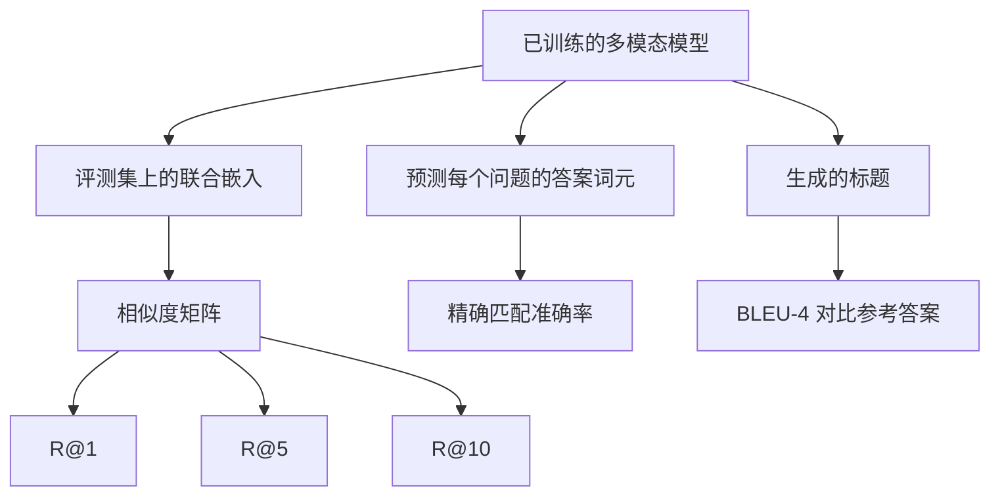

# 多模态评测

> 训练只是循环的一半，另一半是测量。本课从基础原语构建三个评测面：图像—标题检索的 R@1、R@5、R@10；视觉问答的 exact match；以及图像标题生成的 BLEU-4。每个指标都作用于模型输出，合成评测套件可在数秒内运行。

**类型：** 构建
**语言：** Python
**前置课程：** Phase 19 第 58–62 课（编码器、transformer、投影、交叉注意力融合、预训练）
**预计时间：** 约 90 分钟

## 学习目标

- 从图像与标题嵌入的相似度矩阵计算 Recall@K。
- 计算固定答案词表上的视觉问答 exact-match 准确率。
- 不依赖外部库，从生成和参考词元序列计算 BLEU-4。
- 用第 62 课训练模型运行三项评测。

## 问题

训练损失平台期不代表模型完成。训练损失只反映训练分布上的拟合，不能说明模型能否在留出批次中排序、回答问题或写出可接受的标题。以下三种评测面是标准做法：

- **检索（R@1、R@5、R@10）。** 为查询标题构建联合嵌入，按余弦相似度对评测池中的每幅图像排序，报告匹配图像是否落入前 1、前 5、前 10；对称形式（图像到文本）同理。
- **视觉问答（精确匹配）。** 给定（图像，问题），模型输出一个答案词元；精确匹配对每个样本是一比特：预测答案是否等于参考答案，再在评测集上取平均。
- **标题生成（BLEU-4）。** 生成一个标题，针对参考标题计算 1-gram 到 4-gram 精度的几何平均并加上长度惩罚（brevity penalty）；标准形式是多参考（一幅图像，多个参考标题）。

每项都是薄函数，本课在代码中全部实现，让数学具体、让评测面完全可控。真实的 MS-COCO、VQA v2、GQA 和 OK-VQA 也可接入同样的接口。

## 概念



### Recall@K

构建 `(N, N)` 余弦相似度矩阵，按行降序排列列索引；若对角线索引位于前 K 个位置，该查询得分为 1，否则为 0。对转置矩阵做同样计算即可得到标题到图像的对称指标。比如 `N=100` 时，`R@1 = 0.6` 表示 100 个标题中有 60 个把正确图像检索为第一名。

### VQA exact match

对于每个 `(图像, 问题, 答案)`，编码图像、嵌入问题，经解码器融合后读取下一个词元；预测词元 ID 与参考 id 相等即记为正确，最后在评测集上取平均。真实 VQA 数据集每个问题通常有多个人工答案，并使用 soft accuracy：10 名人类标注中至少 3 人同意时得 1，否则按同意人数的比例缩放；本课为保持清晰使用单答案 exact match。

### BLEU-4

BLEU-4 为：

```math
\text{BLEU-4} = \text{BP} \cdot \exp\big(\text{mean}(\log p_1, \log p_2, \log p_3, \log p_4)\big)
```

其中 `p_n` 是修正后的 n-gram precision：生成 n-gram 中出现在任一参考答案里的部分，按参考答案中的最大计数进行 clipped count，再除以生成 n-gram 总数；`BP` 是 brevity penalty：

```math
\text{BP} = \begin{cases} 1 & \text{if generated length} > \text{reference length} \\ \exp(1 - r/g) & \text{otherwise, where } r \text{ is reference length and } g \text{ is generated} \end{cases}
```

小样本中零 precision 需要平滑；实现采用 Chen and Cherry method 1，在零计数时给分子和分母都加 1。

### 合成评测套件

内存中生成 50 个留出样本，沿用第 62 课的 mock corpus 模式，并使用独立的 held-out seed：

- `pairs`：50 个 `(image, caption_ids)` 配对，用于检索；
- `vqa`：50 个 `(image, question_ids, answer_id)` 三元组，用于问答；
- `caps`：50 个 `(image, [reference_caption_ids, ...])` 条目，每幅图最多 3 个参考标题。

套件由 seed 确定性生成，且与训练语料留出，因此模型从未见过这些评测数据。把套件持久化为 JSON 留作练习。

| 指标 | 范围 | N=50 随机基线 |
|---|---|---|
| R@1 | 0 到 1 | 0.02（1 / N） |
| R@5 | 0 到 1 | 0.10 |
| R@10 | 0 到 1 | 0.20 |
| VQA EM | 0 到 1 | 1 / vocab |
| BLEU-4 | 0 到 1 | 较小但非零 |

在合成数据上训练 50 步时，指标不应期待很高；demo 检查的是它们高于随机基线。

```figure
ch-recall-window
```

## 动手构建

`code/main.py` 实现：

- `recall_at_k(sim_matrix, k)`：为两个方向返回 `[0, 1]` 内的浮点数；
- `vqa_exact_match(predictions, references)`：对整数相等取均值；
- `bleu4(generated, references, smoothing=True)`：支持多参考标题；
- `build_eval_suite(seed, n_samples, vocab_size, max_len)`：返回三个确定性的评测列表；
- `evaluate(model, suite)`：运行三个指标并返回数字字典；
- demo：加载第 62 课刚初始化的多模态模型，先评测，再训练 50 步后再次评测，打印前后指标。

```bash
python3 code/main.py
```

演示会打印训练前后表格；指标应从接近随机上升到高于随机基线。

## 使用

每个指标都能直接映射到生产基准：

- **检索。** MS-COCO 5K val 和 Flickr30K 都是同一相似度矩阵上的 R@K 问题。ImageNet zero-shot 也使用该矩阵，每个类别一个提示词嵌入，但它报告的是 top-1 分类准确率，也就是对类别提示词的 R@1；把合成评测换成真实文件，函数签名保持不变。
- **VQA。** VQA v2、GQA、OK-VQA 使用相同的 exact-match 形状（VQA v2 用 soft accuracy 代替单答案 EM）。
- **BLEU-4。** MS-COCO captioning、NoCaps、Flickr30K captioning 都使用 BLEU-4，并加上 CIDEr 和 METEOR；增加 CIDEr 只是再写一个函数。

真实基准只需把 `build_eval_suite` 换成加载器，函数主体不变，数学与基准无关。

## 测试

`code/test_main.py` 覆盖：

- recall@k 在完美单位相似度矩阵上返回 1.0，在 k < N 时对翻转矩阵返回 0.0
- recall@k 遵守 `k <= N` 上界
- 当生成结果与某条参考完全相同时，bleu4 返回 1.0
- 在词表不相交时 bleu4 返回 0.0
- VQA 精确匹配等于相等对的比例
- build_eval_suite 返回预期数量的 pairs、vqa 条目和 caption 条目

运行方式：

```bash
python3 -m unittest code/test_main.py
```

## 练习

1. 在标题指标中加入 CIDEr；它对 n-gram 使用 TF-IDF 加权，更奖励信息量大的词元。
2. 实现 soft-accuracy VQA：为每题保留多个人工答案，若有匹配则准确率为 `min(human_count / 3, 1)`，复现 VQA v2。
3. 增加 NaN-safe 的 `bleu4` 变体，处理空生成序列而不崩溃。
4. 在 R@K 之外计算平均倒数排名（MRR）；MRR 关注正确项在 top-K 之后的具体位置，R@K 关注它是否进入 top-K。
5. 在训练第 0、10、20、30、40、50 步的五个检查点（共六个时间点）运行评测并绘制学习曲线，确认指标轨迹跟随损失轨迹。

## 关键术语

| 术语 | 含义 |
|---|---|
| R@K | 正确匹配位于前 K 个结果的查询比例 |
| Exact match | 预测答案等于参考答案 |
| BLEU-4 | 1–4 gram precision 几何平均并带 brevity penalty |
| Multi-reference | 一幅图像接受多个参考标题 |
| Held-out | 与训练语料 seed 不相交的评测集 |

## 延伸阅读

- VQA v2 的 soft-accuracy 公式。
- CIDEr 的 TF-IDF n-gram 标题评测。
- Papineni 等（2002）的 BLEU 原论文。
- MS-COCO 标准评测脚本。
